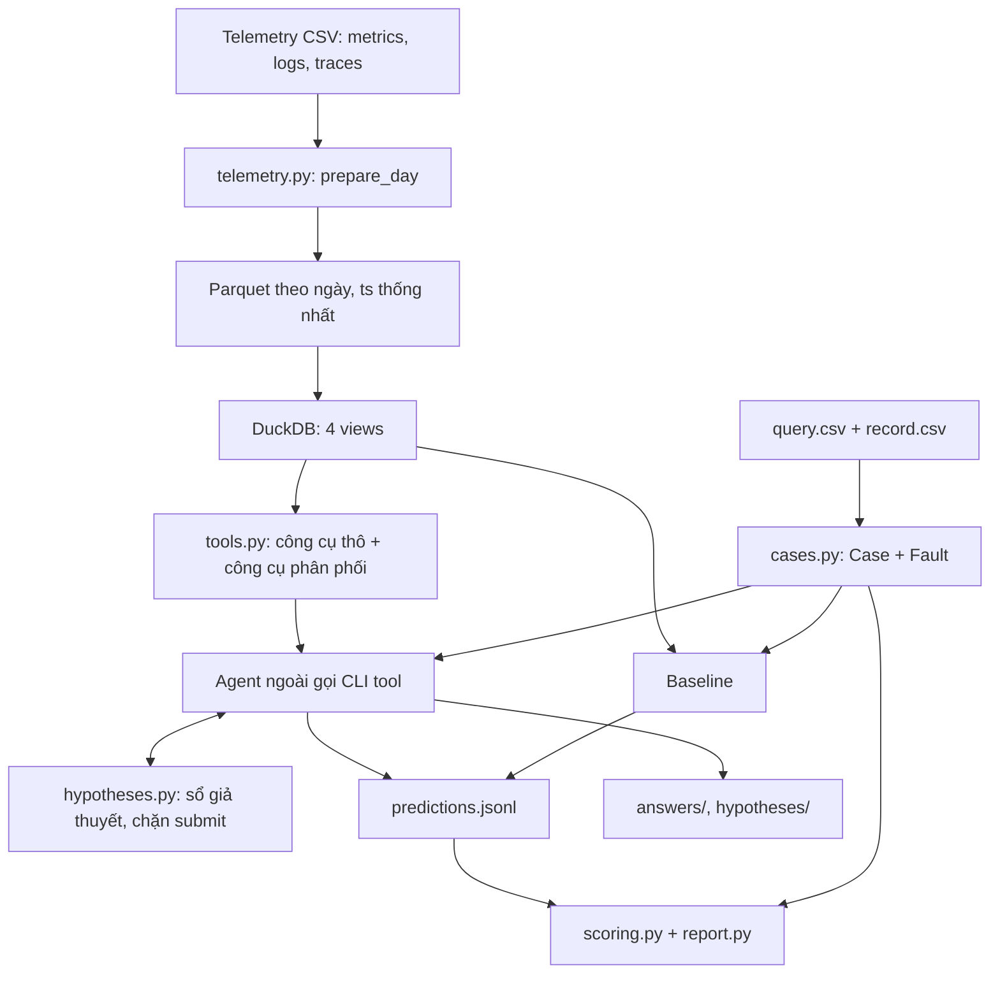

# OpenRCA agent — kiến trúc hiện tại và đánh giá

Project thử nghiệm **Root Cause Analysis (RCA) offline** trên dữ liệu Bank của
[OpenRCA](https://github.com/microsoft/OpenRCA). Đầu vào là câu hỏi về một khoảng
thời gian cùng metrics, logs và traces; đầu ra là danh sách nguyên nhân gồm
`time`, `component`, `reason`, được chấm với nhãn của bộ dữ liệu.

**Đánh giá tổng thể:** nền tảng nghiên cứu nhỏ, dễ đọc, có pipeline dữ liệu và
bộ chấm rõ ràng. Baseline và agent tự gọi công cụ tạo cơ sở để so sánh các
cách suy luận. Phần điều phối LLM, kiểm tra đáp án và quản lý
thí nghiệm vẫn ở mức prototype; chưa đủ cơ sở để dùng cho vận hành production.

Tài liệu phản ánh mã nguồn ngày **19/11/2026**. Các nhánh thử nghiệm đã bỏ
(agent Ollama, Codex, TraceRCA, TORAI, multi-source BARO) còn lưu ở branch
`backup/experiments-2026-11-04`; workflow cố định (code chọn bằng chứng theo
luật, LLM chỉ chọn đáp án, lệnh `workflow`/`flow`) đã bỏ ngày 18/11/2026 và còn
trong lịch sử git (commit `8814a2b`).
Tên thư mục vẫn là `human-in-the-loop-infra`, nhưng code hiện tại là package
Python `rca`, chạy qua CLI. HITL console cũ nằm ở branch `archive/hitl-infra`
(tag `hitl-infra-final`). Bản hiện tại chưa có UI, dịch vụ API, bước phê duyệt
của con người hay hành động tự sửa hạ tầng; có CLI để điều tra và ghi đáp án
thủ công.

## 1. Kiến trúc tổng quan

Ứng dụng chạy trong một tiến trình Python, xử lý tuần tự từng case. DuckDB
truy vấn Parquet tại máy. LLM nằm ngoài package: một agent (ví dụ Claude) gọi
CLI `tool` để điều tra và ghi đáp án.
Không có database server hay hàng đợi trong luồng hiện tại.



Oracle, random và import đáp án OpenRCA chỉ cần cases; các baseline thống kê
mới đọc telemetry. `Case` hiện chứa cả câu hỏi lẫn ground truth, nên ranh giới
inference/evaluation dựa vào cách sử dụng code, chưa được đảm bảo bằng các
kiểu dữ liệu riêng.

| File | Trách nhiệm hiện tại |
|---|---|
| [rca/__main__.py](rca/__main__.py) | CLI, chọn case/ngày/run, điều phối và ghi kết quả. |
| [rca/cases.py](rca/cases.py) | Parse khung giờ, scoring points; ghép query với record; tạo `Case`, `Fault`. |
| [rca/bank.py](rca/bank.py) | Không gian đáp án cố định: 14 components, 8 reasons. |
| [rca/telemetry.py](rca/telemetry.py) | CSV → Parquet, chuẩn hóa timestamp, tạo DuckDB views. |
| [rca/baselines.py](rca/baselines.py) | Oracle, random, import predictions lưu sẵn của OpenRCA. |
| [rca/statistical.py](rca/statistical.py) | Xếp hạng metric bằng z-score/IQR; ánh xạ KPI sang reason. |
| [rca/baro.py](rca/baro.py) | Tích hợp `fse-baro`: BOCPD tìm điểm thay đổi, robust score xếp hạng metric. |
| [rca/exclusive_time.py](rca/exclusive_time.py) | Exclusive time từng component theo phút (theo CRISP), so với giờ trước; tool `exclusive`. |
| [rca/microrank.py](rca/microrank.py) | MicroRank: PageRank cá nhân hóa trên đồ thị operation–trace và Ochiai theo đúng bài báo (Eq. 2, 4–8); trace bất thường chọn theo p99 cùng loại hoặc lời gọi thất bại thay cho Eq. 1. Tool `traces`. |
| [rca/onset.py](rca/onset.py) | Kiểm chứng giả thuyết: mốc bắt đầu lệch của một component theo mức nghiêm trọng so với nền (theo OpenRCA 2.0), lùi mốc theo FChain, và thứ tự thời gian với các máy gọi nó. Tool `onset`. |
| [rca/tools.py](rca/tools.py) | Công cụ điều tra cho agent ngoài gọi qua CLI; ghi đáp án qua `submit`. |
| [rca/hypotheses.py](rca/hypotheses.py) | Sổ giả thuyết của agent; điều kiện để `submit` nhận đáp án. |
| [rca/scoring.py](rca/scoring.py), [rca/report.py](rca/report.py) | Đọc/ghi predictions, chấm từng trường, tổng hợp theo case, độ khó và reason. |
| [tests/](tests/) | Kiểm thử parser, scorer, chuyển đổi telemetry, KPI → reason, exclusive time, MicroRank (tái tạo ví dụ số trong bài báo), sổ giả thuyết và onset. |

## 2. Dữ liệu và hợp đồng giữa các lớp

### Phạm vi Bank

| Ngày telemetry, UTC+8 | Vai trò | Số câu hỏi đánh giá |
|---|---|---:|
| 2021-03-05 | Ngày bình thường để tham chiếu | 0 |
| 2021-03-09 | Đánh giá | 21 |
| 2021-03-25 | Đánh giá | 19 |

`query.csv` chứa 136 câu hỏi Bank; `baseline`, `score`
mặc định chọn hai ngày đánh giá trên: **40 câu hỏi, 44 lỗi**. Bốn case có hai
lỗi là `bank-104`, `bank-109`, `bank-121`, `bank-131`. Lệnh `cases` không truyền
ngày sẽ liệt kê toàn bộ câu hỏi, bao gồm ground truth.

`load_cases()` lấy trường cần chấm từ `scoring_points`, rồi tìm record khớp
trong cửa sổ thời gian; không ghép query/record theo số dòng. Case ID như
`bank-018` được tạo từ vị trí dòng trong `query.csv`, vì vậy thứ tự file này
là một phần của hợp đồng dữ liệu.

### Telemetry store

| DuckDB view | CSV nguồn trong mỗi ngày | Nội dung chính |
|---|---|---|
| `metric_app` | `metric/metric_app.csv` | KPI nghiệp vụ theo service: `sr`, `mrt`, `cnt`, `rr`, `tc`. |
| `metric_container` | `metric/metric_container.csv` | Metric theo `cmdb_id`, `kpi_name`, `value`. |
| `trace` | `trace/trace_span.csv` | Component, quan hệ parent/span, trace ID, duration. |
| `log` | `log/log_service.csv` | Component, loại log, nội dung dòng log. |

- CSV có schema và escape tường minh. Trace IDs giữ dạng chuỗi để tránh tràn
  số; `escape='"'` xử lý dấu nháy kép xuất hiện muộn trong log CSV.
- Mọi nguồn có `ts` dạng epoch giây (`DOUBLE`); cửa sổ là `start <= ts < end`.
  Câu hỏi, record và chuỗi thời gian đáp án dùng **UTC+8**.
- Đơn vị timestamp được nhận bằng độ lớn: trace ngày 05/03 và 09/03 dùng mili
  giây, ngày 25/03 dùng giây. Chuẩn hóa không khôi phục phần mili giây đã thiếu.
- Mỗi ngày/nguồn thành một Parquet nén Zstandard, sắp theo `ts`. Chuyển đổi ghi
  `.parquet.part` rồi đổi tên; file đích đã tồn tại được bỏ qua. Chưa có
  checksum/version để tự phát hiện CSV đã đổi hoặc cache cũ.
- DuckDB tạo views trên mọi ngày đã chuẩn bị. Giới hạn bộ nhớ mặc định là
  3 GB khi chuyển đổi và 2 GB khi truy vấn; không bao gồm NumPy/pandas.

### Đáp án và artifacts

```text
data/
  Bank.zip
  openrca/Bank/{query.csv,record.csv,telemetry/<day>/...}
  parquet/Bank/<day>/{trace,log,metric_container,metric_app}.parquet
runs/<run>/
  predictions.jsonl           # Đầu vào chung của scorer
  findings.jsonl              # Top 5 findings/case của z-score hoặc IQR
  answers/<case>.json         # Đáp án từ tool submit
  hypotheses/<case>.json      # Sổ giả thuyết của agent
```

Các file tùy theo nhánh chạy, không phải run nào cũng có đủ. `data/`, `runs/`
và `.venv/` được gitignore. Một dòng predictions có dạng:

```json
{"case_id":"bank-018","answers":[{"time":"2021-03-09 11:20:00","component":"Tomcat01","reason":"network latency"}]}
```

## 3. Hai nhánh tạo đáp án

### Baseline không dùng LLM

- **Oracle:** dùng ground truth kiểm tra bộ chấm; 100% là kiểm tra tính nhất
  quán, không phải năng lực suy luận.
- **Random:** chọn ngẫu nhiên phút, component, reason; có seed để tái lập.
- **OpenRCA agent archive:** import predictions có sẵn, không gọi agent ngoài.
- **Z-score / IQR:** so từng metric với mức tham chiếu bằng độ lệch hai phía.
  Onset là điểm đầu có score ≥ 3, hoặc điểm cực đại nếu không đạt ngưỡng.
  Regex KPI quyết định reason; chọn component khác nhau cho case nhiều lỗi.
- **BARO:** dựng bảng theo phút từ metrics, điền thiếu bằng `ffill/bfill`, dùng
  BOCPD tìm điểm thay đổi trong cửa sổ; nếu không có thì dùng đầu cửa sổ.
  Robust score ưu tiên chuỗi tăng sau điểm chia. Baseline lấy component khác
  nhau và dùng cùng thời điểm chia cho các đáp án của case.

Z-score/IQR hỗ trợ `before` (một giờ trước) hoặc `normal-day` (cùng giờ ngày
05/03, mở rộng 30 phút mỗi phía). Với `before`, chỉ khi không có findings mới
fallback sang `normal-day`. BARO không có fallback normal-day tương đương.

### Agent tự gọi công cụ (`tool`)

Một agent bên ngoài (ví dụ Claude) đọc câu hỏi bằng `tool question`, rồi tự
điều tra qua CLI. Mọi lệnh có dạng `python -m rca tool <công cụ> <case> ...`.
Công cụ chỉ thấy câu hỏi và telemetry, không thấy nhãn. Công cụ cũng không mang
kiến thức về ý nghĩa tín hiệu (không có luật kiểu "CPU cao → CPU fault"): công
cụ thô in dữ liệu, công cụ thống kê xếp hạng cái gì lệch khỏi bình thường,
ngữ nghĩa do agent tự suy ra.

| Công cụ | Nhóm | Nguồn dữ liệu | Trả lời câu hỏi |
|---|---|---|---|
| `question` | — | câu hỏi | Đề bài, không gian đáp án, cách dùng công cụ |
| `overview` | thô | `metric_app`, `log`, `trace` | Hệ thống có đang hỏng không, từ phút nào |
| `calls` | thô | `trace` | Cặp gọi nào bị chậm đi hoặc ít đi |
| `series` | thô | `metric_container` | Một KPI của một máy thay đổi thế nào từng phút |
| `logs` | thô | `log` | Máy có ghi log gì lạ không |
| `baro` | thống kê | `metric_container`, `metric_app` | Chuỗi metric nào lệch mạnh nhất sau điểm thay đổi |
| `exclusive` | thống kê | `trace` | Máy nào tự xử lý chậm đi, hay mạng vào máy nào chậm đi |
| `traces` | thống kê | `trace` | Máy nào xuất hiện nhiều trong trace bất thường |
| `onset` | kiểm chứng | cả ba | Máy nghi ngờ lệch từ lúc nào, máy gọi nó lệch trước hay sau |
| `hypothesis` | quy trình | sổ giả thuyết | Ghi và kiểm giả thuyết |
| `submit` | quy trình | — | Ghi đáp án |

**Mức bình thường** mà công cụ dùng để so sánh chưa thống nhất:

| Công cụ | So với |
|---|---|
| `overview`, `calls`, `series` | Một giờ trước cửa sổ. Nếu giờ đó không có `metric_app` thì dùng cùng giờ ngày 05/03, ngày gần như không có tải và có nhiều sự kiện không nhãn |
| `baro`, `exclusive`, `traces` | Một giờ trước cửa sổ |
| `onset` | 15 mẫu ngay trước từng điểm |
| `logs` | Không so sánh, chỉ in cửa sổ |

Công cụ trả về rỗng không có nghĩa là không có sự cố.

#### `question`

In đề bài, khung giờ (UTC+8), 14 component và 8 reason được phép trả lời, danh
sách công cụ và cách submit. Mặc định nó in kèm luật của vòng giả thuyết.
`tool --protocol free question ...` bỏ phần đó.

#### `overview`

Ba bảng, số đếm được quy về cùng độ dài cửa sổ:

1. **KPI nghiệp vụ từng phút**, gộp mọi service: tỉ lệ thành công (`sr`), thời
   gian phản hồi (`mrt`, ms), số request (`cnt`). Dòng đầu ghi mức bình thường.
2. **Số dòng log** theo component và loại log, trong cửa sổ so với bình thường.
3. **Số span và duration trung bình** theo component, trong cửa sổ so với bình thường.

Dùng để biết có sự cố người dùng thấy được hay không và nó xảy ra trong khoảng
nào. Lỗi tài nguyên trên Bank thường chỉ bùng khoảng 5 phút rồi hồi, nên phải
đọc từng phút chứ không chỉ nhìn trung bình.

#### `calls`

Mỗi cặp `caller -> callee` lấy từ trace: số lời gọi và thời gian gọi trung
bình (là span phía gọi), trong cửa sổ so với bình thường. Một lời gọi là một
span có span con nằm trên máy khác.

Nếu một máy nhận chậm đi ở mọi cặp gọi vào nó, nghi máy đó hoặc mạng vào nó.
Nếu số lời gọi tới nó giảm thì nghi lời gọi thất bại. Bảng chỉ có trung bình
nên chưa tách được trễ mạng (mọi lời gọi chậm đều) với mất gói (đa số bình
thường, một phần bị timeout hoặc gửi lại). Trên 30 ca held-out, đây là nguồn
nhầm lẫn lớn nhất còn lại.

#### `series <component> <pattern>`

In giá trị từng phút của các KPI của một máy có tên chứa `<pattern>` (không
phân biệt hoa thường), kèm mean và std lúc bình thường. Nếu khớp hơn 6 KPI thì
chỉ in 6 và liệt kê tên các KPI còn lại. `""` liệt kê mọi KPI của máy đó.

Dùng để nhìn tận mắt hình dạng chuỗi mà `baro` hay `onset` đã chỉ ra: một
gai, một bậc kéo dài vài phút, hay trôi dần.

#### `logs <component> [--grep TEXT] [--samples N]`

Số dòng log từng phút theo loại log, và N dòng mẫu (mặc định 10, lấy mẫu cố
định để chạy lại cho cùng kết quả). `--grep` chỉ giữ dòng chứa TEXT.

Lỗi tài nguyên trên Bank (RAM, CPU, đọc đĩa, đầy đĩa) gần như không để lại
dòng log. IG và MG không có log. Ngoại lệ đã thấy là bank-114: log GC của
Tomcat02 tăng từ 0,6 lên 27,5 dòng/phút. Log hữu ích để loại trừ hoặc xác
nhận, ít khi đủ để tìm ra lỗi.

#### `baro [--component C] [--top N]`

BARO (Pham et al., FSE 2024), dùng package `fse-baro` của tác giả
([rca/baro.py](rca/baro.py)):

1. Dựng bảng theo phút cho giờ trước và cửa sổ: mọi chuỗi `metric_container`,
   cùng `<service>_latency` và `<service>_error` (= 100 − sr) của từng service.
2. BOCPD nhiều chiều trên các cột latency và error tìm điểm thay đổi. Điểm đầu
   tiên nằm trong cửa sổ là mốc chia. Nếu không có điểm nào thì mốc chia là đầu cửa sổ.
3. Mỗi chuỗi được chấm `max((x − median) / IQR)` sau mốc chia, so với trước mốc.
   `onset` là phút đầu tiên đạt điểm ≥ 3.

Kết quả gồm điểm, onset, median và đỉnh của từng chuỗi, xếp theo điểm.

Giới hạn:
- **Mốc chia thường sai.** Trên 136 ca, chỉ 33 ca có mốc trong ±60 s so với
  nhãn, 64 ca rơi về đầu cửa sổ.
- **Chấm từng điểm.** Một gai một phút được điểm như một sự cố kéo dài, và
  chuỗi tăng chậm dần không được ưu tiên.
- **IQR = 0 tính là 1.** Vì thế chuỗi gần như hằng (ví dụ `NoCacheMemPerc`
  46,94 → 47,03) có thể đạt điểm cao dù chỉ đổi 0,1%.

Agent phải tự xem median → đỉnh để quyết định đó là nhiễu hay lỗi thật.

#### `exclusive`

Exclusive time theo CRISP (Zhang et al., USENIX ATC 2022), xem
[rca/exclusive_time.py](rca/exclusive_time.py). Mỗi span chỉ giữ phần thời gian
không chờ span con, nên một máy chỉ ngồi chờ máy khác không bị đổ lỗi. Trace
Bank gần như tuần tự, và ba ngày 23–25/3 chỉ có timestamp tới giây, nên
critical path là cả trace và exclusive time = duration − tổng duration của span
con (tối thiểu 0). Mỗi máy có hai chuỗi theo phút:

- `processing`: phần máy tự xử lý trong các span phía server của nó.
- `network in`: span gọi của máy gọi trừ span của máy được gọi, tức thời gian
  trên đường mạng và trong hàng đợi trước khi vào máy.

Mỗi phút được chấm `(x − median) / IQR` so với giờ trước (IQR dưới 1 ms tính
là 1 ms). Kết quả in các đoạn phút liên tiếp có điểm ≥ 3, mạnh nhất trước,
kèm mức bình thường → đỉnh (ms) và khoảng thời gian.

`processing` tăng gợi ý lỗi trong máy. `network in` tăng gợi ý lỗi mạng vào
máy. Chỉ áp dụng cho máy có trace (IG, Tomcat, MG). Lời gọi timeout không để
lại span phía nhận thì bị bỏ qua.

#### `traces`

MicroRank (Yu et al., WWW 2021), xem [rca/microrank.py](rca/microrank.py).

1. Chọn trace bất thường. Một trace bất thường khi chậm hơn p99 của các trace
   cùng hình dạng (cùng coverage tree) trong giờ trước, hoặc có lời gọi không
   để lại span ở phía nhận.
2. Chạy PageRank cá nhân hóa trên đồ thị operation–trace, một lần cho trace bất
   thường và một lần cho trace bình thường (Eq. 2, 4–7).
3. Xếp hạng bằng Ochiai (Eq. 8). Kết quả in 8 máy đầu và điểm của chúng.

Điểm khác với bài báo:
- Eq. 1 của bài báo cộng ngưỡng μ + 1,5σ của mọi span. Trên Bank ngưỡng này gần
  như không đánh dấu trace nào (70/136 ca không có trace bất thường), nên được
  thay bằng p99 như trên.
- Bank không có tên operation, nên operation được phân biệt theo component và
  phía outgoing/server của span.
- d, ω và số vòng lặp lấy theo code của tác giả (0,85; 0,01; 25).

Chỉ xếp hạng IG, Tomcat, MG và docker. Apache, Mysql và Redis không có trace.

#### `onset <component> [--pattern P] [--top N]`

Công cụ kiểm chứng một giả thuyết đã có, không dùng để dò lỗi
([rca/onset.py](rca/onset.py)). Với mỗi chuỗi của một máy (metric, exclusive
time, duration trung bình của span):

- **Counter được lấy hiệu.** Chuỗi không bao giờ giảm trong giờ trước được coi
  là counter và xét trên hiệu giữa các phút.
- **Nền là 15 mẫu ngay trước** (tối thiểu 8). Nếu nền nằm trên một giá trị ở ít
  nhất một nửa số mẫu thì dùng mức phân vị, giống OpenRCA 2.0:
  - critical: > P99,9 hoặc > 2 × P99
  - warning: > P99 hoặc > 1,5 × P99
  - moderate: > P90 hoặc > 1,2 × P99

  Nếu không thì dùng mức z 3 / 2 / 1,5, chỉ xét chiều tăng.
- **Một lần lệch** là ít nhất 2 mẫu liên tiếp ở mức warning trở lên. Mốc được
  lùi qua các mẫu moderate ngay trước nó (FChain, ICDCS 2013). Mỗi chuỗi lấy
  lần lệch dài nhất.

Kết quả in onset, số mẫu, mức, nền → đỉnh và tên chuỗi, xếp theo onset. Phía
dưới là các máy gọi máy này (từ trace, tính bắc cầu, kèm số bước), mỗi máy kèm
lúc duration span của nó bắt đầu lệch. Máy nào lệch sớm hơn 60 s so với lần
lệch đầu tiên của máy đang xét thì bị đánh dấu `(before ...)`, vì lỗi lan từ
dưới lên không thể làm máy phía trên lệch trước.

Ví dụ với bank-114: CPU Tomcat02 lệch lúc 16:22, số thread lúc 16:23, các máy
gọi IG01 và IG02 cùng lúc 16:23. Thứ tự này khớp với giả thuyết lỗi ở Tomcat02.

Giới hạn:
- Lần lệch dài nhất có thể là chuỗi trôi dần hoặc gần như hằng, ví dụ
  `NoCacheMemPerc` 46,94 → 47,03 ở bank-018. Agent phải đọc nền → đỉnh.
- Quét mọi chuỗi của mọi máy theo cách này thì mốc đúng (±60 s) chỉ đạt
  20–25% ca, nên không dùng `onset` làm bộ dò.

#### `hypothesis <case> add | test | list`

Sổ giả thuyết ([rca/hypotheses.py](rca/hypotheses.py)), lưu ở
`runs/<run>/hypotheses/<case>.json`. Đây là protocol mặc định.

- `add --component X --reason "..." --if-true "..." --if-false "..."`: thêm
  giả thuyết, kèm điều agent phải thấy nếu nó đúng và nếu nó sai.
- `test <id> --status supported|refuted|open --evidence "..."`: ghi kết quả
  kiểm, bằng chứng phải nêu công cụ và con số.
- `list`: in sổ.

Sổ không chứa kiến thức về hệ thống. Nó chỉ buộc agent cân nhắc phương án khác
trước khi chốt.

#### `submit <case> --time ... --component ... --reason ... [--append]`

Kiểm tra định dạng `YYYY-MM-DD HH:MM:SS` và tên component/reason hợp lệ, ghi
`runs/<run>/answers/<case>.json`, rồi tổng hợp lại `predictions.jsonl`. Ca nhiều
lỗi thì submit từng lỗi, từ lỗi thứ hai thêm `--append`.

Với protocol giả thuyết, đáp án chỉ được nhận khi khớp một giả thuyết
`supported` và có ít nhất một giả thuyết khác đã bị `refuted`.
`tool --protocol free submit ...` bỏ điều kiện này.

#### Cửa sổ bình thường và hồ sơ hệ thống

Thay `<case>` bằng `normal-YYYY_MM_DD-HHMM` để mở một cửa sổ 30 phút không có
câu hỏi. Cửa sổ này phải cách mọi cửa sổ đề bài ít nhất một giờ, nếu không
CLI từ chối. Mọi công cụ trừ `submit` đều chạy được trên đó, để agent xem hệ
thống lúc khỏe trông thế nào.

[profiles/bank.md](profiles/bank.md) là hồ sơ hệ thống lúc khỏe do một agent
Sonnet viết từ 6 cửa sổ như vậy: kiến trúc gọi, mức nền và các loại nhiễu
thường gặp như các đợt đọc đĩa ngắn hoặc CPU một core vọt lên. Package không
chứa vòng lặp gọi LLM. Luật "không đọc dữ liệu đáp án" nằm trong lời dặn cho agent.

#### Kết quả

Kết quả của Sonnet (effort medium), mỗi cấu hình chạy một lần (2026-11-06; cột
hồ sơ chạy 2026-11-19). Các run này không dùng `onset`.

| Bộ ca | Giả thuyết + hồ sơ | Vòng giả thuyết | Tự do (cùng ngân sách) | z-score |
|---|---|---|---|---|
| 20 ca held-out | chưa chạy | 18/20 | chưa chạy | 6/20 |
| 30 ca held-out mới | 23/30 | 19/30 | 15/30 | 10/30 |

Trên 30 ca, thêm hồ sơ hệ thống làm 5 ca chuyển thành đúng và 1 ca chuyển
thành sai. Kiểm định dấu một phía cho p ≈ 0,11, chưa có ý nghĩa thống kê. Lỗi
mất gói đúng 9/12 ca, trước là 6/12.

Các lỗi còn lại:
- nhầm trễ mạng với mất gói;
- lỗi ở apache, máy không có trace;
- chọn nhầm sự kiện trong cửa sổ.

## 4. Chấm điểm và kết quả đang có

Scorer triển khai các quy tắc được mô tả theo OpenRCA:

- Mỗi task chấm một số trường trong `time`, `component`, `reason`.
- Thời gian đúng khi lệch không quá 60 giây; component/reason khớp chính xác.
- Sai số lượng nguyên nhân thì toàn bộ trường của case nhận 0 điểm.
- Với nhiều lỗi, thử các hoán vị và chọn cách ghép nhiều trường đúng nhất.
- Điểm case = số trường đúng / số trường được chấm; `solved` khi điểm bằng 1.
  `strict` là tỷ lệ case solved; `partial` là trung bình điểm các case,
  không phải tỷ lệ gộp mọi trường. Task 1–3/easy, 4–6/middle, 7/hard.
- Case thiếu prediction vẫn nằm trong mẫu số và được chấm 0.

Snapshot tính ngày 30/10/2026 từ predictions đã lưu; thư mục `runs/` đã được
xóa ngày 04/11/2026, các baseline chạy lại được bằng lệnh ở mục 6. Các run
không có manifest gắn với revision/prompt/model digest, nên bảng không chứng
minh code hiện tại sẽ tái tạo y hệt.

| Run đủ 40 case | Giải đúng | Partial |
|---|---:|---:|
| `oracle` | 40/40 | 100,0% |
| `agent-tools` | 30/40 | 82,3% |
| `zscore-before` | 13/40 | 37,7% |
| `iqr-before` | 10/40 | 33,8% |
| `baro` | 7/40 | 25,0% |
| `openrca-agent` | 4/40 | 14,6% |
| `random` (file đã lưu) | 4/40 | 17,7% |
| `iqr-normal-day` | 3/40 | 13,8% |
| `zscore-normal-day` | 2/40 | 13,1% |

`agent-tools` là đáp án của agent Claude gọi CLI `tool` (bốn subagent, mỗi
case một lần); các công cụ và lời dặn được viết sau khi đã xem một số case
dev, nên con số này lạc quan. Oracle cũng không phải đối thủ RCA thực tế.

Mốc may rủi qua seed 0–1999: random trung bình giải đúng 1,9/40, partial 11,1%;
11,65% lần thử đạt ít nhất 4/40. Chênh lệch vài case cần được diễn giải cùng
coverage, loại task và cách chọn tập đánh giá.

Qua bước kiểm tra bằng chứng không đảm bảo đáp án đúng: kiểm tra chỉ xét
bằng chứng có khớp loại lỗi và thời điểm hay không. Repo hiện không kèm
scorer/archive chính thức để kiểm chứng lại tuyên bố tương đương bộ chấm
OpenRCA trên toàn bộ 136 câu hỏi.

## 5. Đánh giá kiến trúc

### Điểm mạnh

- **Nền dữ liệu phù hợp nghiên cứu offline:** schema rõ, xử lý UTC+8, đơn vị
  timestamp và ID dạng text; Parquet + DuckDB giảm nhu cầu hạ tầng riêng.
- **Có thước đo chung:** mọi nhánh xuất cùng `Answer`/JSONL và dùng cùng scorer.
  Oracle/random giúp phát hiện lỗi chấm và diễn giải kết quả của run nhỏ.
- **Dễ lần theo quyết định:** thuật toán ở các module riêng; sổ giả thuyết ghi
  lại agent đã bác hay ủng hộ giả thuyết nào, bằng bằng chứng gì.
- **Công cụ không mang ngữ nghĩa:** công cụ chỉ báo cái gì lệch khỏi bình thường;
  agent tự đọc tên metric, dòng log để suy ra loại lỗi.
- **Kết hợp nhiều nguồn tín hiệu:** metrics, traces và logs bổ sung cho nhau ở
  các component có độ phủ telemetry khác nhau.

### Hạn chế cần xử lý

| Vấn đề thấy trong code | Ảnh hưởng |
|---|---|
| Dependencies chính chỉ khai báo DuckDB, nhưng CLI import `tools → microrank → numpy` ngay khi khởi động. | Cài mặc định sạch thiếu NumPy có thể lỗi cả `--help`. Group `baro` đang cung cấp NumPy gián tiếp. |
| `Case` truyền vào phần suy luận chứa `faults`; số đáp án lấy từ `len(case.faults)`. | Prompt không nhận các giá trị ground truth, nhưng inference vẫn phụ thuộc nhãn và chưa có ranh giới chống dùng nhãn nhầm. |
| Công cụ trace chỉ báo trung bình mỗi phút. | Mất gói và trễ mạng có cùng dạng trung bình; đây là nhóm agent sai nhiều nhất. |
| BARO thay IQR = 0 bằng 1. | Chuỗi gần như hằng số (đọc đĩa lẻ tẻ, NoHeap) cho điểm rất cao, lấn át lỗi thật. |
| BARO fallback về đầu cửa sổ nhưng phần mô tả vẫn gọi đó là BOCPD change point. | Report chưa phân biệt điểm thay đổi phát hiện được với mốc mặc định. |
| Topology, KPI regex, component/reason và ngày bình thường gắn cứng với Bank. | `--system` đổi đường dẫn, chưa biến hệ thống thành RCA đa dataset. |
| Thiếu manifest run; ghi predictions chưa atomic; chạy lại cùng tên tái sử dụng kết quả cũ. | Khó tái lập/so sánh sạch; lỗi khi chạy lại có thể để lại đáp án cũ. Chưa phù hợp nhiều worker ghi cùng run. |
| Tests tập trung ở parser, scorer, telemetry, KPI mapping, MicroRank, exclusive time và sổ giả thuyết. | Chưa có test cho BARO, các công cụ CLI và quản lý artifacts. |

BARO dùng pandas và điền dữ liệu nhìn cả cửa sổ; MicroRank dùng ma trận NumPy
dense theo operations/traces. Đây là thiết kế offline, chưa có benchmark tài
nguyên để khẳng định khả năng xử lý stream hay tải production. Các ngưỡng và
`confidence` của LLM cũng chưa được hiệu chỉnh bằng đánh giá độc lập.

### Thứ tự cải thiện đề xuất

1. **Làm kết quả đáng tin hơn:** khai báo dependency trực tiếp; kiểm tra response
   và thời gian ở runtime; lưu `accepted/rejected/error` sau verify; giữ dự đoán
   thô để vẫn chấm được kết quả thất bại.
2. **Tách inference/evaluation:** input chỉ có câu hỏi, cửa sổ và số lỗi lấy từ
   yêu cầu; giữ `Fault` ở lớp chấm. Gom cấu hình Bank vào adapter.
3. **Làm thí nghiệm tái lập được:** lưu code revision, cấu hình/prompt, model
   digest, seed và tập case; ghi atomic; quy định resume/overwrite; so sánh
   trên cùng tập case, báo riêng case lỗi/thiếu.
4. **Cải thiện evidence rồi đánh giá lại:** hợp nhất candidates với ưu tiên rõ
   giữa các nguồn; thống nhất reference/missing data; thêm test multi-fault,
   duplicate, timeout và JSON lỗi. Sau đó mở rộng bước review của người dùng
   nếu mục tiêu là hỗ trợ vận hành HITL.

## 6. Cách chạy với code hiện tại

Cần Python ≥ 3.13, `uv`, dữ liệu `Bank.zip`. Các ví dụ dùng group `baro` để có đủ dependency cho toàn bộ CLI hiện
tại, bao gồm NumPy đang được import gián tiếp.

```bash
# Đặt Bank.zip vào data/, giải nén có chọn lọc.
unzip -q data/Bank.zip 'Bank/query.csv' 'Bank/record.csv' \
  'Bank/telemetry/2021_03_05/*' 'Bank/telemetry/2021_03_09/*' \
  'Bank/telemetry/2021_03_25/*' -d data/openrca

uv sync --group baro
uv run --group baro python -m rca prepare
uv run --group baro python -m rca cases 2021_03_09 2021_03_25 --counts
uv run --group baro pytest
```

Tạo baseline và chấm kết quả:

```bash
uv run --group baro python -m rca baseline oracle
uv run --group baro python -m rca baseline random --seed 0
uv run --group baro python -m rca baseline zscore --reference before
uv run --group baro python -m rca baseline iqr --reference normal-day
uv run --group baro python -m rca baseline baro
uv run --group baro python -m rca baseline openrca-agent \
  --archive path/to/OpenRCA/rca/archive/agent-Bank.csv
uv run --group baro python -m rca score runs/*/predictions.jsonl
```

Điều tra một case như một agent:

```bash
uv run --group baro python -m rca tool question bank-018
uv run --group baro python -m rca tool overview bank-018
uv run --group baro python -m rca tool baro bank-018 --top 10
uv run --group baro python -m rca tool exclusive bank-018
uv run --group baro python -m rca tool calls bank-018
uv run --group baro python -m rca tool series bank-018 Tomcat01 CPU
uv run --group baro python -m rca tool traces bank-018
uv run --group baro python -m rca tool onset bank-018 Tomcat01
uv run --group baro python -m rca tool hypothesis bank-018 --run demo add --component Tomcat01 \
  --reason "network latency" --if-true "..." --if-false "..."
uv run --group baro python -m rca tool question normal-2021_03_06-0930
uv run --group baro python -m rca score runs/demo/predictions.jsonl --cases bank-018 --detail
```

Dùng tên `--run` mới cho mỗi thí nghiệm cần tách biệt. Tùy chọn chung `--data`,
`--system`, `--runs` đứng **trước** subcommand, ví dụ
`python -m rca --data /path/to/data cases 2021_03_09`.

Ngày 19/11/2026, **48 tests đều pass** bằng
`uv run --group baro pytest -q`.
# rca-agent
