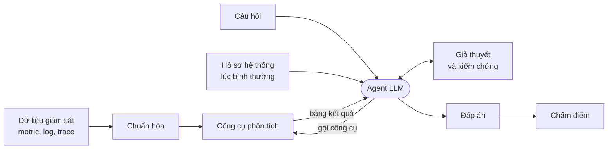

# rca-agent

Dùng LLM để tìm nguyên nhân gốc (root cause) của sự cố trong một hệ thống phần
mềm gồm nhiều máy và dịch vụ, đánh giá trên bộ dữ liệu
[OpenRCA](https://github.com/microsoft/OpenRCA).

## 1. Giới thiệu

### 1.1 Bài toán

Một hệ thống phần mềm lớn, ví dụ của ngân hàng, gồm hàng chục máy gọi nhau.
Máy chủ web nhận request của người dùng và chuyển cho máy chủ ứng dụng. Máy chủ
ứng dụng lại gọi database, cache và các dịch vụ khác. Khi một máy gặp sự cố, ví
dụ CPU quá tải, hết bộ nhớ hay mạng chậm, lỗi lan theo chuỗi gọi đó và người dùng
thấy request chậm hoặc thất bại.

Lúc đó đội vận hành phải trả lời ba câu hỏi:

- **Khi nào** sự cố bắt đầu?
- **Ở máy nào** (component)?
- **Vì sao** (reason): CPU, bộ nhớ, mạng hay đĩa?

Đây là bài toán **root cause analysis (RCA)**. Nó khó vì ba lý do:

- **Dữ liệu rất nhiều.** Chỉ riêng ngày 2021-03-09, hệ Bank có 23 triệu bản ghi
  trace, 2,2 triệu dòng log và 1,2 triệu giá trị metric (mục 1.3 giải thích ba
  loại dữ liệu này).
- **Triệu chứng thường không nằm ở chỗ gây lỗi.** Máy gọi tới máy hỏng cũng chậm
  theo. Trong khi đó, máy hỏng có thể không ghi trace hay log nào.
- **Lúc bình thường dữ liệu cũng có nhiễu.** CPU thỉnh thoảng vọt lên, đĩa có
  những đợt đọc ngắn. Không phải chỗ nào lệch cũng là lỗi.

OpenRCA (Microsoft, ICLR 2025) là bộ benchmark kiểm tra LLM có làm được bài toán
này hay không. Nó gồm 335 sự cố lấy từ 3 hệ thống doanh nghiệp, kèm hơn 68 GB dữ
liệu giám sát. Trong bài báo, cấu hình tốt nhất (Claude 3.5 với RCA-agent của
nhóm tác giả) chỉ giải đúng 11,34% số ca. LLM không thể đọc thẳng hàng GB dữ liệu
thô: nó phải viết code hoặc gọi công cụ để rút gọn dữ liệu trước.

Project này hỏi: **nếu cho LLM những công cụ phân tích tốt, nó có tìm đúng nguyên
nhân hơn không?**

### 1.2 Hướng tiếp cận

Ý tưởng chính: **không bắt LLM đọc dữ liệu thô.** Project viết sẵn một bộ công cụ
phân tích. Mỗi công cụ là một lệnh chạy trên terminal. Nó đọc dữ liệu của khoảng
thời gian cần điều tra, so với lúc hệ thống chạy bình thường, rồi in ra một bảng
ngắn, chỉ vài chục dòng.

LLM đóng vai một kỹ sư vận hành. Nó tự chọn chạy công cụ nào, đọc bảng kết quả,
đặt giả thuyết, kiểm tra giả thuyết, rồi nộp đáp án.

Một LLM làm việc theo cách này gọi là **agent**: nó không trả lời một lần là xong,
mà được chạy lệnh, xem kết quả, quyết định bước tiếp theo, và lặp lại tới khi có
đáp án. Agent trong project là Claude Sonnet, chạy trong Claude Code, một công cụ
của Anthropic cho phép LLM chạy lệnh trên máy tính.

```text
 dữ liệu giám sát của OpenRCA (file CSV, hàng GB)
        │  chuẩn hóa, làm một lần
        ▼
 dữ liệu cùng một định dạng cho mọi hệ thống
        │  mỗi lần agent chạy một công cụ
        ▼
 bảng kết quả ngắn (vài chục dòng chữ) ──────► agent đọc và suy luận
        ▲                                             │
        └─────────── agent chạy công cụ tiếp ◄────────┤
                                                      │ khi đã đủ bằng chứng
                                                      ▼
                                        nộp đáp án ──► chấm điểm
```

Năm thành phần của project:

1. **Chuẩn hóa dữ liệu.** Mỗi hệ thống trong OpenRCA có định dạng file riêng.
   Project đổi tất cả về cùng bốn bảng: KPI nghiệp vụ, metric, trace và log.
   - Dữ liệu được lưu dạng **Parquet**, một định dạng file đọc nhanh hơn CSV
     nhiều lần.
   - **DuckDB** là một thư viện cơ sở dữ liệu chạy ngay trong chương trình. Nó
     cho phép viết SQL trên các file đó mà không cần cài máy chủ database.
2. **Công cụ phân tích.** Mỗi công cụ là một lệnh
   `python -m rca tool <tên công cụ> <mã câu hỏi>`, chia làm ba nhóm:
   - **Xem dữ liệu:** in số liệu đã gom theo từng phút. Ví dụ, `overview` in số
     request, tỉ lệ thành công và thời gian phản hồi của mỗi phút.
   - **Thuật toán RCA:** ba phương pháp đã được công bố trong các bài báo khoa học.
     Mỗi phương pháp xếp hạng xem chỉ số nào, hoặc máy nào, lệch khỏi bình thường
     nhiều nhất. Phần 2 giải thích từng phương pháp.
   - **Kiểm chứng:** `onset` cho biết một máy bắt đầu bất thường từ lúc nào, và
     các máy gọi tới nó bất thường trước hay sau nó.

   Công cụ chỉ báo **cái gì khác bình thường**, không kết luận nguyên nhân. Ví dụ,
   công cụ có thể báo "CPU của Tomcat02 tăng từ 27% lên 80%", nhưng không nói
   "vậy lỗi là CPU". Việc kết luận là của LLM.
3. **Vòng giả thuyết.** Để agent không chốt ngay thứ đầu tiên trông đáng ngờ, nó
   phải làm ba bước:
   - ghi ra các nguyên nhân có thể (máy + lý do). Mỗi nguyên nhân kèm hai dự đoán:
     nếu đúng thì công cụ sẽ cho thấy gì, nếu sai thì sẽ cho thấy gì;
   - chạy công cụ để kiểm từng nguyên nhân;
   - đánh dấu nguyên nhân nào được bằng chứng ủng hộ, nguyên nhân nào bị bác.

   Lệnh nộp đáp án sẽ từ chối, nếu chưa có ít nhất một giả thuyết được ủng hộ và
   một giả thuyết khác đã bị bác.
4. **Hồ sơ hệ thống.** LLM không biết hệ Bank lúc bình thường trông thế nào. Ví dụ,
   nó không biết CPU 30% ở máy này là bình thường hay đã cao. Vì vậy, trước khi
   giải câu hỏi, một agent khác chạy chính các công cụ đó trên những khoảng thời
   gian không có sự cố. Agent này viết lại những gì nó thấy vào
   [profiles/bank.md](profiles/bank.md): máy nào gọi máy nào, các chỉ số thường ở
   mức nào, và những dao động nào là bình thường. Agent giải câu hỏi được đọc file
   này trước khi bắt đầu.
5. **Làm mù và chấm điểm.** Để kết quả công bằng, agent giải câu hỏi chỉ được chạy
   công cụ và đọc hồ sơ hệ thống. Nó không được mở file đáp án, mã nguồn hay kết
   quả cũ.
   - Đáp án được chấm theo đúng luật của OpenRCA (mục 1.5).
   - Kết quả được so với các phương pháp không dùng LLM: đoán ngẫu nhiên, và hai
     phương pháp thống kê (z-score, BARO) tự đưa ra đáp án.

Mã nguồn của project chỉ gồm phần chuẩn hóa dữ liệu, các công cụ và bộ chấm điểm.
Agent được khởi chạy riêng, bên ngoài mã nguồn.

### 1.3 Bộ dữ liệu

OpenRCA có ba hệ thống: Bank, Telecom và Market. Project dùng **Bank** là chính,
đã thử trên **Telecom**, và chưa dùng Market.

Ngày giờ trong câu hỏi, trong đáp án và trong tên thư mục dữ liệu đều theo giờ
UTC+8. Cột `timestamp` trong các file là **epoch**: số giây (hoặc mili giây) tính
từ 00:00 ngày 1/1/1970 giờ UTC, cách máy tính thường dùng để lưu thời điểm. Ví dụ,
1615219200 là 2021-03-09 00:00 giờ UTC+8.

Dữ liệu của mỗi hệ thống nằm trong các thư mục theo ngày, ví dụ
`Bank/telemetry/2021_03_09/`, mỗi thư mục có ba thư mục con `metric/`, `trace/`
và `log/`.

#### Ba loại dữ liệu giám sát (telemetry)

- **Metric:** chuỗi số theo thời gian. Ví dụ: % CPU của Tomcat01, khoảng mỗi phút
  một giá trị.
- **Log:** các dòng chữ do phần mềm tự ghi ra. Ví dụ: một dòng access log cho mỗi
  request, hoặc một dòng mỗi lần JVM dọn bộ nhớ (GC).
- **Trace:** hành trình của một request qua các máy. Một trace gồm nhiều **span**.
  Mỗi span là một đoạn công việc trên một máy, có thời lượng, và trỏ tới span cha
  (span đã gọi nó). Nối span con với span cha sẽ biết máy nào gọi máy nào, và mỗi
  bước mất bao lâu.

Hai khái niệm dùng xuyên suốt:

- **component:** tên một máy hoặc dịch vụ. Trong dữ liệu, cột này tên là `cmdb_id`.
- **KPI:** tên một loại metric, ví dụ `OSLinux-CPU_CPU_CPUCpuUtil` là % CPU.

#### Hệ Bank

Hệ thống ngân hàng. Bảng dưới là lượng dữ liệu của một ngày (2021-03-09):

| Loại | File | Số dòng một ngày |
|---|---|---:|
| KPI nghiệp vụ | `metric/metric_app.csv` | 13 838 |
| Metric từng máy | `metric/metric_container.csv` | 1,2 triệu |
| Trace | `trace/trace_span.csv` | 23 triệu span (khoảng 14 span mỗi trace) |
| Log | `log/log_service.csv` | 2,2 triệu |

Đường đi của một request, lấy từ trace (mũi tên là "gọi tới"):

```text
IG01, IG02 ──> Tomcat01..04 ──> MG01, MG02 ⇄ dockerA1, dockerA2, dockerB1, dockerB2
```

OpenRCA không mô tả vai trò của IG và MG. Từ trace chỉ thấy được rằng IG là nơi
request đi vào đầu tiên, rồi IG chuyển cho Tomcat (máy chủ ứng dụng Java). Tomcat
gọi MG, và MG gọi qua lại với bốn container docker.

Không phải máy nào cũng có đủ ba loại dữ liệu:

| Nhóm | Máy | Số KPI | Log | Trace | Có thể là đáp án |
|---|---|---:|---|---|---|
| apache (web) | apache01, apache02 | 82 | `apache_access_log` | không | có |
| Tomcat (ứng dụng) | Tomcat01–04 | 108–111 | `localhost_access_log`, `gc`, `catalina`, `localhost` (tùy máy) | có | có |
| IG | IG01, IG02 | 90 | không | có | có |
| MG | MG01, MG02 | 94 | không | có | có |
| Mysql (database) | Mysql01, Mysql02 | 226 | `slow`, `error` | không | có |
| Redis (cache) | Redis01, Redis02 | 111–115 | không | không | có |
| docker | dockerA1, A2, B1, B2 | 6–11 | không | có | không |

Bảng này cho thấy hai điều:

- **Trace không đi qua apache, Mysql và Redis.** Muốn tìm lỗi ở các máy này, chỉ có
  thể dựa vào metric, và vào log nếu máy đó có log.
- **Bốn container docker có trace, nhưng không nằm trong danh sách đáp án.**

Các field của từng file, kèm giá trị ví dụ lấy từ dữ liệu thật:

**`metric_app.csv`**: KPI nghiệp vụ, mỗi dòng là một service trong một phút. Có
11 service.

| Field | Ý nghĩa | Ví dụ |
|---|---|---|
| `timestamp` | thời điểm, epoch giây | 1615219140 |
| `tc` | tên service | ServiceTest8 |
| `cnt` | số request trong phút | 53 |
| `sr` | tỉ lệ request thành công, % | 67.85 |
| `mrt` | thời gian phản hồi trung bình, ms | 4963.58 |
| `rr` | một tỉ lệ % khác; OpenRCA không mô tả, project không dùng | 88.68 |

**`metric_container.csv`**: metric của từng máy, mỗi dòng một giá trị. Mỗi KPI có
một mẫu khoảng mỗi 60–120 giây.

| Field | Ý nghĩa | Ví dụ |
|---|---|---|
| `timestamp` | epoch giây | 1615219200 |
| `cmdb_id` | máy | Tomcat04 |
| `kpi_name` | tên metric | OSLinux-CPU_CPU_CPUCpuUtil |
| `value` | giá trị | 26.1244 |

**`trace_span.csv`**: mỗi dòng là một span.

| Field | Ý nghĩa | Ví dụ |
|---|---|---|
| `timestamp` | lúc span bắt đầu, epoch mili giây | 1615219199819 |
| `cmdb_id` | máy chạy span | MG02 |
| `trace_id` | request mà span thuộc về | gw0120210308235959026392 |
| `span_id` | mã của span | 21030800016503820235 |
| `parent_id` | mã của span đã gọi span này | 369-bcou-st-c514cf3a-91289@2611-… |
| `duration` | thời lượng, ms | 9 |

Span có mã bắt đầu bằng `369-` là lời gọi đi, nằm ở phía máy gọi. Con của nó là
span ở phía máy được gọi. Ba ngày 23–25/3, thời điểm span chỉ chính xác tới giây.

**`log_service.csv`**: mỗi dòng là một dòng log.

| Field | Ý nghĩa | Ví dụ |
|---|---|---|
| `log_id` | mã dòng log | 4049f5bd0b8a64f1… |
| `timestamp` | epoch giây | 1615256887 |
| `cmdb_id` | máy | Tomcat04 |
| `log_name` | loại log | localhost |
| `value` | nội dung | INFO [localhost-startStop-2] … Destroying Spring FrameworkServlet 'dynamic' |

#### Hệ Telecom

Hệ thống viễn thông. Có 43 component để chọn làm đáp án:

- `os_001`–`os_022`: máy chủ (node);
- `docker_001`–`docker_008`: container chạy ứng dụng;
- `db_001`–`db_013`: database.

So với Bank, Telecom khác ở ba điểm:

- **Không có log.**
- **Mỗi ngày chỉ có dữ liệu từ 00:00 đến 06:00.**
- **Trace chỉ có span của 9 component:** os_021, os_022 và 7 docker. Ba database
  db_003, db_007, db_009 chỉ xuất hiện gián tiếp, qua lời gọi JDBC. Dữ liệu không
  cho biết docker nào chạy trên máy os nào.

Kiến trúc gọi, lấy từ trace:

```text
os_021, os_022 (OSB, cổng vào) ──> docker_00x ⇄ docker_00y ──JDBC──> db_003, db_007, db_009
```

| File | Field | Ghi chú (ngày 2020-05-26) |
|---|---|---|
| `metric/metric_app.csv` | `serviceName`, `startTime` (epoch ms), `avg_time`, `num`, `succee_num`, `succee_rate` | một service, `osb_001`, mỗi phút một dòng |
| `metric/metric_node.csv` | `itemid`, `name`, `bomc_id`, `timestamp` (epoch ms), `value`, `cmdb_id` | 22 máy os, 51 metric |
| `metric/metric_container.csv` | như trên | 8 docker, 9 metric |
| `metric/metric_service.csv` | như trên | 13 database, 46 metric |
| `metric/metric_middleware.csv` | như trên | 12 redis, 22 metric; redis không có trong tập đáp án |
| `trace/trace_span.csv` | `callType`, `startTime` (epoch ms), `elapsedTime` (ms), `success`, `traceId`, `id`, `pid` (span cha), `cmdb_id`, `dsName`, `serviceName` | 9,6 triệu span |

`callType` cho biết loại span:

- `OSB`: điểm request đi vào hệ thống;
- `CSF`, `RemoteProcess`, `FlyRemote`, `LOCAL`: lời gọi giữa các docker, và việc
  xử lý bên trong một docker;
- `JDBC`: docker truy vấn database. JDBC là cách một chương trình Java kết nối tới
  database. Tên database được gọi nằm ở cột `dsName`, vì bản thân database không
  ghi span.

#### Nhãn: `record.csv`

Mỗi dòng là một sự cố đã được ghi nhận, và là đáp án mà câu hỏi dùng để chấm.

| Field | Ý nghĩa | Ví dụ (Bank) |
|---|---|---|
| `level` | loại component: `node` là máy chủ, `pod` là một máy hoặc container chạy ứng dụng, `service` là dịch vụ như database. Bank chỉ có `pod`. | pod |
| `component` | máy gây lỗi | Redis02 |
| `timestamp`, `datetime` | lúc lỗi bắt đầu | 1614852540, 2021-03-04 18:09:00 |
| `reason` | lý do | high memory usage |

### 1.4 Bộ câu hỏi

`query.csv` có ba cột: `task_index`, `instruction` (câu hỏi bằng tiếng Anh) và
`scoring_points` (các ô sẽ được chấm). Mỗi câu hỏi:

- chỉ ra một khoảng thời gian **30 phút**;
- nói trong khoảng đó có mấy sự cố;
- hỏi một, hai hoặc cả ba trường: thời điểm, máy, lý do.

Ví dụ, câu bank-036:

> There were two failures reported within the time range of March 12, 2021, from
> 16:00 to 16:30. The exact components affected, the occurrence times of the root
> causes, and the underlying reasons for these failures are currently unknown.
> Please identify the root cause occurrence datetime, the root cause component,
> and the root cause reason.

Phần `scoring_points` của câu này (agent không được thấy):

```text
The 1-th root cause occurrence time is within 1 minutes (i.e., <=1min) of 2021-03-12 16:26:00
The 1-th predicted root cause component is apache02
The 1-th predicted root cause reason is network packet loss
The 2-th root cause occurrence time is within 1 minutes (i.e., <=1min) of 2021-03-12 16:15:00
The 2-th predicted root cause component is IG02
The 2-th predicted root cause reason is high disk I/O read usage
```

Có 7 loại câu hỏi, khác nhau ở trường được hỏi:

| Loại | Hỏi | Độ khó | Bank | Telecom |
|---|---|---|---:|---:|
| task_1 | thời điểm | dễ | 25 | 10 |
| task_2 | lý do | dễ | 22 | 10 |
| task_3 | máy | dễ | 15 | 4 |
| task_4 | thời điểm + lý do | trung bình | 18 | 8 |
| task_5 | thời điểm + máy | trung bình | 18 | 4 |
| task_6 | máy + lý do | trung bình | 21 | 6 |
| task_7 | cả ba | khó | 17 | 9 |
| | **Tổng** | | **136** | **51** |

Ở Bank, 118 câu có một sự cố và 18 câu có hai sự cố. Mọi câu của Telecom có
một sự cố.

Đáp án phải chọn đúng tên trong danh sách cho trước.

| | Bank | Telecom |
|---|---|---|
| Máy | 14: apache01–02, Tomcat01–04, MG01–02, IG01–02, Mysql01–02, Redis01–02 | 43: os_001–022, docker_001–008, db_001–013 |
| Lý do | 8: high CPU usage, high memory usage, network latency, network packet loss, high disk I/O read usage, high disk space usage, high JVM CPU load, JVM Out of Memory (OOM) Heap | 5: CPU fault, network delay, network loss, db connection limit, db close |

Số sự cố theo lý do:

- **Bank:** network packet loss 36, high CPU usage 35, network latency 30, high
  disk I/O read usage 24, high memory usage 11, JVM OOM Heap 10, high disk space
  usage 5, high JVM CPU load 3.
- **Telecom:** CPU fault 19, network delay 13, db connection limit 7, network
  loss 7, db close 5.

### 1.5 Cách chấm điểm

Luật chấm giống script chấm chính thức của OpenRCA (`main/evaluate.py`) và được
viết lại trong [rca/scoring.py](rca/scoring.py).

1. **Một ô cho mỗi trường được hỏi của mỗi sự cố.** Câu bank-036 có 2 sự cố × 3
   trường = 6 ô.
2. **Thời điểm đúng nếu lệch không quá 60 giây** so với nhãn. Máy và lý do phải
   trùng đúng từng chữ.
3. **Số nguyên nhân trả lời phải bằng số sự cố.** Trả lời thiếu hoặc thừa thì mọi
   ô của câu đó bị 0.
4. **Thứ tự các nguyên nhân không quan trọng.** Bộ chấm thử mọi cách ghép đáp án
   với sự cố, rồi lấy cách đúng nhiều ô nhất.
5. **Điểm một câu = số ô đúng / số ô được chấm.** Câu chỉ tính là **giải đúng**
   khi đạt điểm tuyệt đối (1). Con số chính để so sánh là tỉ lệ câu giải đúng.
   Điểm trung bình của các câu (partial) được báo kèm.

Ví dụ: với bank-036, agent trả lời hai nguyên nhân.

| Đáp án | Thời điểm | Máy | Lý do |
|---|---|---|---|
| A | 2021-03-12 16:15:30 | IG02 | high disk I/O read usage |
| B | 2021-03-12 16:27:30 | apache02 | network latency |

Cách ghép tốt nhất là A với sự cố 2 và B với sự cố 1:

- A đúng cả 3 ô.
- B chỉ đúng máy. Thời điểm lệch 90 giây so với 16:26:00, vượt ngưỡng 60 giây; lý
  do cũng sai.

Câu này được 4/6 ô, tức 0,67 điểm, và **không** được tính là giải đúng. Nếu agent
chỉ trả lời một nguyên nhân, câu này được 0 điểm.

Agent trả lời bằng lệnh
`rca tool submit <ca> --time "YYYY-MM-DD HH:MM:SS" --component X --reason "..."`,
mỗi lệnh một nguyên nhân. Đáp án được ghi vào `runs/<run>/predictions.jsonl`, và
`python -m rca score` chấm file này.

## 2. Pipeline: từ dữ liệu tới đáp án

Phần này có ba bước. Mục 2.0 vẽ toàn bộ pipeline. Mục 2.1 là một phiên làm việc
thật của agent trên một câu hỏi. Các mục sau giải thích dữ liệu được chuẩn bị ra
sao, và từng công cụ nhận vào gì, làm gì, trả ra gì.

### 2.0 Tổng quan pipeline



1. Dữ liệu giám sát được chuẩn hóa một lần.
2. Với mỗi câu hỏi, agent đọc hồ sơ hệ thống, rồi lặp lại: gọi công cụ, đọc bảng
   kết quả, nêu và kiểm giả thuyết.
3. Khi đủ bằng chứng, agent nộp đáp án, và đáp án được chấm theo luật OpenRCA.

Agent chỉ tiếp xúc với dữ liệu qua các công cụ, và không bao giờ biết điểm của
mình. Chi tiết từng bước nằm ở các mục dưới.

### 2.1 Một phiên làm việc thật của agent

Phiên dưới đây được chạy ngày 2026-11-19. Agent là Claude Sonnet, làm theo đúng
luật làm mù ở mục 1.2. Riêng cho phiên minh họa này, agent được dặn thêm hai việc:
chạy mỗi lần một công cụ, và viết một câu trước mỗi lệnh cho biết nó muốn tìm hiểu
gì. Phiên kéo dài khoảng 2 phút, với 25 lệnh (kể cả 2 lệnh gõ sai tham số mà agent
tự sửa lại).

Phần lời của agent được dịch sang tiếng Việt. Đầu ra của công cụ giữ nguyên, chỉ
cắt bớt dòng.

**Câu hỏi bank-114.** Agent không biết đáp án. Đáp án được ghi ở đây để người đọc
tiện theo dõi.

| | |
|---|---|
| Đề bài | "During the specified time range of March 9, 2021, from 16:00 to 16:30, the system experienced a single failure. … Please pinpoint the root cause occurrence datetime." |
| Hỏi | chỉ thời điểm (task_1) |
| Đáp án | 2021-03-09 16:23:00, Tomcat02, JVM Out of Memory (OOM) Heap |

#### Bước 0. Đọc hồ sơ hệ thống

Agent đọc [profiles/bank.md](profiles/bank.md). File này cho nó biết ba điều:

- máy nào gọi máy nào;
- máy nào có loại dữ liệu nào;
- lúc bình thường các chỉ số ở mức nào. Ví dụ, CPU của các máy Tomcat thường ở
  khoảng 25–28%.

#### Bước 1. Xem đề bài

```text
$ python -m rca tool question bank-114
During the specified time range of March 9, 2021, from 16:00 to 16:30, the system experienced a single failure. ...
Window: 2021-03-09 16:00 to 2021-03-09 16:30 (UTC+8)
Components (answer with one of these): apache01, apache02, Tomcat01, Tomcat02, ..., Redis01, Redis02
Reasons (answer with one of these): high CPU usage; high memory usage; network latency; ...
Tools, all run as python -m rca tool <name> bank-114 ...:
  overview   business KPIs per minute; log lines and spans per component vs normal
  ...
```

#### Bước 2. Hệ thống có bị ảnh hưởng không, từ lúc nào?

> Agent: "Bắt đầu bằng overview, để xem KPI nghiệp vụ, số log và số span của từng
> máy có lệch không."

```text
$ python -m rca tool overview bank-114
minute  success%  mean_response  requests
16:20     100.0          640.1      1829
16:21     100.0           1070      1674
16:22     100.0            672      1809
16:23     100.0           2139      1723
16:24      98.7           9057      1419
16:25     100.0           5801      1448
...
  Mysql02   error                        9  normal         0
  Tomcat02  gc                         287  normal        22
```

Thời gian phản hồi bắt đầu tăng từ 16:21 và lên đỉnh 9 giây lúc 16:24. Có hai điểm
khác thường: Tomcat02 ghi nhiều log GC hơn hẳn, và Mysql02 ghi log lỗi trong khi
bình thường không có.

#### Bước 3. Nêu hai giả thuyết đầu tiên

```text
$ python -m rca tool hypothesis bank-114 add --component Tomcat02 --reason "JVM Out of Memory (OOM) Heap" \
    --if-true "heap của Tomcat02 gần đầy, log GC tăng vọt, Tomcat02 lệch trước các máy gọi nó" \
    --if-false "heap bình thường, GC tăng sau các bất thường khác"
$ python -m rca tool hypothesis bank-114 add --component Mysql02 --reason "high disk I/O read usage" \
    --if-true "các metric đọc đĩa của Mysql02 tăng trước khi Tomcat chậm" \
    --if-false "metric đĩa của Mysql02 phẳng lúc sự cố bắt đầu, lỗi xuất hiện sau Tomcat02"
```

Agent viết phần "nếu đúng" và "nếu sai" bằng tiếng Anh; ở đây đã dịch và rút gọn.

#### Bước 4. Kiểm Tomcat02: log GC và thời điểm bắt đầu

> Agent: "Log GC của Tomcat02 nổi lên trước tiên, nên xem nó theo từng phút."

```text
$ python -m rca tool logs bank-114 Tomcat02 --samples 5
  gc: 16:00=1 16:01=1 ... 16:21=1 16:23=36 16:24=56 16:25=53 16:26=50 16:27=51 16:28=24 16:29=2
  16:23 [gc] ... [GC (Allocation Failure) ... [ParNew: 865762K->39236K(943744K) ...] 1811020K->984611K(4089472K) ...
```

```text
$ python -m rca tool onset bank-114 Tomcat02
onset  samples  level         baseline ->         peak  series
16:21        8  critical         16.06 ->        155.4  exclusive processing (traces)
16:22        6  critical          4047 ->         4746  OSLinux-OSLinux_MEMORY_MEMORY_UserMem
16:22        4  critical         27.62 ->        79.86  OSLinux-CPU_CPU_CPUCpuUtil
...
Components calling Tomcat02 (from the traces), by hops, and when their span duration deviated:
  IG01      1 hop(s): from 16:23, 6 samples, 541.4 -> 6005.6 ms
  IG02      1 hop(s): from 16:23, 6 samples, 491.3 -> 5490.7 ms
```

Tomcat02 bất thường từ 16:21–16:22. Hai máy gọi nó, IG01 và IG02, bất thường từ
16:23, tức sau nó. Thứ tự này khớp với giả thuyết lỗi bắt đầu ở Tomcat02.

#### Bước 5. Kiểm Mysql02

```text
$ python -m rca tool onset bank-114 Mysql02
16:21        9  critical         16.12 ->        38.41  OSLinux-CPU_CPU_CPUWio
16:21        6  critical         4.695 ->        37.31  Mysql-MySQL_3306_SlowQueries
...
$ python -m rca tool series bank-114 Mysql02 sdc
OSLinux-OSLinux_LOCALDISK_LOCALDISK-sdc_DSKRead (normal mean 0.06 std 0.08)
  16:01=6.53  16:03=0.00 ... 16:21=1.20  16:23=0.27  16:25=2.93  16:27=0.00
OSLinux-OSLinux_LOCALDISK_LOCALDISK-sdc_DSKPercentBusy (normal mean 59.19 std 14.70)
  ... 16:15=50.30  16:17=95.60  16:19=76.80  16:21=99.60  16:23=100.00 ...
$ python -m rca tool logs bank-114 Mysql02
  error: 16:23=2 16:25=2 16:26=2 16:27=2 16:28=1
  16:23 [error] 0 [Note] InnoDB: page_cleaner: 1000ms intended loop took 4277ms. ...
```

Mysql02 cũng lệch từ 16:21, nhưng lượng đọc đĩa gần như bằng 0. Đĩa đã bận 95% từ
16:17, trước khi sự cố bắt đầu. Log lỗi chỉ xuất hiện từ 16:23 và nói về việc ghi
dữ liệu xuống đĩa, không phải đọc.

#### Bước 6. Nhìn toàn hệ thống bằng BARO và exclusive time

```text
$ python -m rca tool baro bank-114 --top 15
Change point: 16:24
   score  onset        median         peak  series
   284.0  16:24          0.00       355.00  Tomcat02|OSLinux-OSLinux_LOCALDISK_LOCALDISK-sdb_DSKReadWrite
   245.4  16:24         26.19        75.95  Tomcat02|OSLinux-CPU_CPU_CPUUserTime
   175.1  16:24       4045.50      4746.00  Tomcat02|OSLinux-OSLinux_MEMORY_MEMORY_UserMem
   ...
    96.3  16:26          0.00        96.30  Mysql02|Mysql-MySQL_3306_Handler Read Next
```

```text
$ python -m rca tool series bank-114 Tomcat02 CPUCpuUtil
OSLinux-CPU_CPU_CPUCpuUtil (normal mean 27.79 std 0.35)
  16:01=27.63 ... 16:20=27.49  16:22=27.99  16:24=79.86  16:25=62.4 ...
```

```text
$ python -m rca tool exclusive bank-114
Tomcat03  network in      1.3 ->   1603.3 ms  score  1602.0  16:23-16:28
Tomcat02  processing     18.4 ->    155.4 ms  score    27.0  16:23-16:25
...
```

BARO xếp các metric của Tomcat02 lên đầu. CPU của Tomcat02 vốn rất ổn định ở khoảng
27,8%, rồi nhảy lên gần 80%. `exclusive` lại cho một ứng viên mới: `network in`
của Tomcat03 tăng từ 1,3 lên 1 603 ms.

#### Bước 7. Thêm hai giả thuyết, rồi kiểm

```text
$ python -m rca tool hypothesis bank-114 add --component Tomcat03 --reason "network latency" \
    --if-true "network in của Tomcat03 tăng trước tiên, CPU và bộ nhớ của nó bình thường" \
    --if-false "Tomcat03 tự xử lý chậm từ lúc hoặc sau Tomcat02; network in tăng chỉ vì hàng đợi"
$ python -m rca tool onset bank-114 Tomcat03
16:21        6  critical         14.85 ->        90.66  exclusive processing (traces)
16:23        6  critical         1.248 ->         1603  exclusive network in (traces)
16:24        4  critical         27.49 ->        59.56  OSLinux-CPU_CPU_CPUCpuUtil
...
$ python -m rca tool series bank-114 Tomcat02 JVMMemoryUsedPercent
Tomcat-MEMORY_7441-MEMORY_JVMMemoryUsedPercent (normal mean 33.20 std 6.23)
  16:08=23.00  16:13=31.00  16:23=41.00  16:28=48.00
$ python -m rca tool hypothesis bank-114 add --component Tomcat02 --reason "high CPU usage" \
    --if-true "CPU Tomcat02 vượt xa mức nền 25–28%, lệch trước các máy gọi nó; heap còn xa mức đầy" \
    --if-false "CPU Tomcat02 phẳng, hoặc máy khác lệch trước"
```

#### Bước 8. Ghi kết quả kiểm cho từng giả thuyết

| # | Giả thuyết | Kết luận | Bằng chứng agent ghi (đã dịch) |
|---|---|---|---|
| 1 | Tomcat02 / JVM OOM Heap | bác | Bộ nhớ JVM chỉ ở 41–48% (bình thường 33%). Log GC cho thấy sau mỗi lần dọn, heap còn khoảng 1,2 GB trên 4,09 GB. GC dày lên là do cấp phát nhiều, không phải do hết bộ nhớ. |
| 2 | Mysql02 / high disk I/O read usage | bác | Lượng đọc đĩa gần 0. Đĩa đã bận 95% từ 16:17. Log lỗi từ 16:23 nói về ghi, không phải đọc. BARO xếp Tomcat02 cao hơn hẳn. |
| 3 | Tomcat03 / network latency | bác | CPU Tomcat03 chỉ tăng từ 16:24, sau Tomcat02. Không chuỗi mạng nào của Tomcat03 lệch. `network in` tăng là do hàng đợi khi hệ thống quá tải. |
| 4 | Tomcat02 / high CPU usage | ủng hộ | CPU 27,6 → 79,9%, trong khi độ lệch chuẩn lúc bình thường chỉ 0,35. Bắt đầu lúc 16:22, trước các máy gọi nó (16:23) và trước CPU Tomcat03 (16:24). |

Với giả thuyết 3 có một chỗ agent đọc chưa kỹ. Theo `onset`, phần `processing`
của Tomcat03 cũng bắt đầu lệch từ 16:21, cùng lúc với Tomcat02; chỉ CPU của nó là
lệch sau.

#### Bước 9. Nộp đáp án

> Agent: "Giả thuyết 4 được ủng hộ, ba giả thuyết khác đã bị bác. Tôi chọn
> 16:22:00, vì các tín hiệu sớm nhất của Tomcat02 nằm ở 16:21 và 16:22."

```text
$ python -m rca tool submit bank-114 --time "2021-03-09 16:22:00" --component Tomcat02 --reason "high CPU usage"
bank-114: 1 answer(s) recorded
```

#### Kết quả chấm

```text
$ python -m rca score runs/demo-session-bank-114/predictions.jsonl --cases bank-114 --detail
  bank-114 task_1 1.00  time ok
```

Câu này chỉ hỏi thời điểm. Agent trả lời 16:22:00, nhãn là 16:23:00. Hai thời điểm
lệch nhau 60 giây, nằm trong ngưỡng cho phép, nên câu được 1,00 điểm.

Agent tìm đúng máy, nhưng **sai lý do**. Lý do thật là JVM OOM Heap, chính là giả
thuyết 1 mà agent đã bác. Agent chờ thấy heap gần đầy mới chịu kết luận OOM. Trong
khi đó, GC dày lên và bộ nhớ JVM tăng dần (23 → 48%) chính là dấu hiệu của lỗi
này. Câu hỏi không chấm lý do nên agent không mất điểm.

Ví dụ này cho thấy hai điều về cách project hoạt động:

- **Công cụ chỉ đưa ra số liệu. Kết luận là của agent, và agent có thể kết luận
  sai.**
- **Được điểm chưa chắc đã suy luận đúng toàn bộ.**

### 2.2 Dữ liệu được chuẩn bị thế nào

Trước khi dùng được, dữ liệu phải qua một bước chuẩn hóa, chỉ làm một lần:

```bash
python -m rca prepare
```

Lệnh này đọc các file CSV của từng ngày và ghi ra file Parquet ở
`data/parquet/<hệ>/<ngày>/`. Có ba việc được làm trong bước này:

1. **Đổi mọi thời điểm về cùng một đơn vị**, là epoch giây, trong cột `ts`. Dữ
   liệu gốc lẫn lộn giây và mili giây.
2. **Đổi tên cột cho giống nhau giữa các hệ.** Ví dụ, thời gian phản hồi ở Bank
   tên là `mrt`, ở Telecom tên là `avg_time`; sau bước này cả hai đều là `mrt`.
3. **Gộp lại thành bốn bảng.** Telecom có bốn file metric riêng (máy chủ,
   container, database, middleware); chúng được gộp vào một bảng `metric_container`.

| Bảng | Cột | Ý nghĩa |
|---|---|---|
| `metric_app` | `ts`, `tc`, `sr`, `mrt`, `cnt` | mỗi phút, mỗi service: tỉ lệ thành công (%), thời gian phản hồi trung bình, số request |
| `metric_container` | `ts`, `cmdb_id`, `kpi_name`, `value` | một giá trị của một metric trên một máy |
| `trace` | `ts`, `cmdb_id`, `trace_id`, `span_id`, `parent_id`, `duration`, `is_call`, `call_target` | một span |
| `log` | `ts`, `log_id`, `cmdb_id`, `log_name`, `value` | một dòng log (Telecom không có) |

Bảng `trace` có thêm hai cột mà dữ liệu gốc không có sẵn:

- `is_call`: span này có phải là một **lời gọi sang máy khác** hay không. Ở Bank,
  đó là span có mã bắt đầu bằng `369-`. Ở Telecom, đó là span có `callType` là
  `CSF` hoặc `JDBC`.
- `call_target`: tên máy được gọi, dùng khi máy đó không tự ghi span. Ở Telecom,
  đây là database của lời gọi JDBC. Ở Bank, cột này luôn trống.

Nhờ bước này, mọi công cụ phía sau chạy được trên cả Bank lẫn Telecom mà không cần
biết đang làm với hệ nào.

### 2.3 Khi agent chạy một công cụ

```text
agent gõ lệnh:  python -m rca tool overview bank-114
                  │
                  │  1. tra query.csv: bank-114 là câu hỏi về 16:00–16:30 ngày 2021-03-09, hệ Bank
                  │  2. mở các file Parquet bằng DuckDB
                  │  3. chạy truy vấn: lấy dữ liệu của 30 phút đó và của "lúc bình thường",
                  │     so sánh, tính điểm, sắp xếp
                  │  4. in kết quả ra màn hình dưới dạng bảng chữ, rồi kết thúc
                  ▼
agent đọc bảng chữ đó, giống như người đọc kết quả một lệnh trên terminal
```

Ba điều cần biết:

- **Agent chỉ thấy những gì được in ra.** Mọi tính toán ở giữa không tới được
  agent. Ví dụ, BARO dựng một bảng 90 phút × 1 670 chuỗi số, nhưng chỉ in ra 20
  dòng đầu của bảng xếp hạng.
- **Mỗi lệnh chạy độc lập.** Chạy xong là thoát, không nhớ gì từ lệnh trước. Thứ
  duy nhất được lưu lại giữa các lệnh là sổ giả thuyết và đáp án đã nộp.
- **"Lúc bình thường" là một giờ ngay trước khoảng thời gian của câu hỏi.** Với câu
  hỏi 16:00–16:30, đó là 15:00–16:00. Riêng ở Bank, nếu giờ đó không có dữ liệu
  KPI nghiệp vụ, `overview`, `calls` và `series` lấy cùng giờ của ngày 2021-03-05,
  một ngày không có sự cố.

### 2.4 Vài khái niệm thống kê dùng trong các công cụ

Các công cụ thống kê đều làm cùng một việc: so một giá trị với mức bình thường
của chính nó, và cho một **điểm lệch**. Điểm càng cao thì càng khác thường.

- **Trung vị (median):** giá trị đứng giữa khi sắp các giá trị theo thứ tự. Khác
  với trung bình, nó không bị kéo đi bởi vài giá trị đột biến.
- **IQR:** khoảng cách giữa giá trị ở vị trí 25% và ở vị trí 75% khi sắp theo thứ
  tự. Nó cho biết lúc bình thường giá trị dao động rộng hay hẹp.
- **Điểm lệch** = (giá trị − trung vị) / IQR.

  Ví dụ: lúc bình thường CPU của một máy có trung vị 26% và IQR 2%. Một phút CPU
  lên 76% thì điểm lệch là (76 − 26) / 2 = 25. Lệch 25 lần độ dao động thường
  ngày là rất bất thường. Các công cụ thường coi điểm từ 3 trở lên là đáng chú ý.
- **z-score:** giống điểm lệch, nhưng dùng trung bình và độ lệch chuẩn thay cho
  trung vị và IQR.
- **Phân vị 99 (p99):** giá trị mà 99% số mẫu nằm dưới nó. Ví dụ, "chậm hơn p99"
  nghĩa là chậm hơn 99% số request lúc bình thường.

Một điểm yếu chung: nếu lúc bình thường một chuỗi gần như không đổi, IQR gần bằng
0, và chỉ một thay đổi rất nhỏ cũng cho điểm lệch rất lớn. Vì vậy agent phải nhìn
cả giá trị thật, không chỉ nhìn điểm.

### 2.5 Từng công cụ

Mọi ví dụ đầu ra dưới đây lấy từ câu hỏi bank-114 ở mục 2.1. Nếu thấy khó hiểu các thuật toán BARO, exclusive time, MicroRank và onset, hãy đọc chương 3 trước.

#### `question <câu hỏi>`: đề bài là gì?

- **Nhận vào:** dòng của câu hỏi trong `query.csv`.
- **Trả ra:** đề bài, khoảng thời gian, danh sách máy và lý do được phép trả lời,
  danh sách công cụ, và luật của vòng giả thuyết. Agent luôn chạy lệnh này đầu
  tiên.

#### `overview <câu hỏi>`: người dùng có bị ảnh hưởng không, từ phút nào?

- **Nhận vào:** `metric_app`, `log` và `trace`, của 30 phút cần điều tra và của
  lúc bình thường.
- **Làm gì:**
  - gộp mọi service lại theo từng phút: tỉ lệ thành công và thời gian phản hồi
    lấy trung bình, số request lấy tổng;
  - đếm số dòng log theo từng máy và từng loại log;
  - đếm số span và thời lượng trung bình theo từng máy;
  - quy số đếm lúc bình thường về cùng độ dài 30 phút, để so trực tiếp được.
- **Trả ra:** ba bảng. Hai bảng đầu trông như sau:

```text
Business KPIs, all services (normal: success 99.4%, mean response 997.4, 1938 requests/min)
minute  success%  mean_response  requests
16:20     100.0          640.1      1829
16:21     100.0           1070      1674
16:22     100.0            672      1809
16:23     100.0           2139      1723
16:24      98.7           9057      1419
16:25     100.0           5801      1448
...
Log lines per component and log (window vs normal, scaled to the window length)
  Tomcat01  gc                          22  normal        24
  Tomcat02  gc                         287  normal        22
...
```

Đọc bảng này: từ 16:21, thời gian phản hồi bắt đầu tăng, đỉnh là 9 057 ms lúc
16:24. Máy Tomcat02 ghi 287 dòng log GC, trong khi bình thường chỉ 22 dòng.

#### `calls <câu hỏi>`: lời gọi giữa hai máy nào bị chậm đi hay ít đi?

- **Nhận vào:** `trace`.
- **Làm gì:**
  - nối mỗi span với span cha của nó. Nếu hai span nằm trên hai máy khác nhau, đó
    là một lời gọi từ máy cha sang máy con;
  - với mỗi cặp máy, đếm số lời gọi và tính thời lượng trung bình của lời gọi,
    trong 30 phút đó và lúc bình thường.
- **Trả ra:**

```text
caller    -> callee       calls   normal    mean ms    normal
IG01      -> Tomcat02      6355     7252     1012.5     628.5
IG01      -> Tomcat03      5757     7269      932.0     625.1
Tomcat02  -> MG01          6414     7245      853.9     502.2
...
```

#### `series <câu hỏi> <máy> <chữ>`: một metric cụ thể thay đổi thế nào?

- **Nhận vào:** `metric_container` của một máy, chỉ các metric có tên chứa `<chữ>`.
- **Trả ra:** tối đa 6 metric. Với mỗi metric: trung bình và độ lệch chuẩn lúc
  bình thường, rồi từng giá trị trong 30 phút. Truyền `""` để liệt kê tên mọi
  metric của máy.

```text
Tomcat-MEMORY_7441-MEMORY_JVMMemoryUsedPercent (normal mean 33.20 std 6.23)
  16:08=23.00  16:13=31.00  16:23=41.00  16:28=48.00
```

Metric này chỉ có một giá trị mỗi 5 phút.

#### `logs <câu hỏi> <máy> [--grep CHỮ]`: máy đó ghi log gì?

- **Nhận vào:** `log` của một máy; chỉ giữ các dòng chứa `CHỮ` nếu có `--grep`.
- **Trả ra:** số dòng log mỗi phút theo từng loại log, và vài dòng mẫu (mặc định
  10 dòng).

```text
  gc: 16:00=1 16:01=1 ... 16:21=1 16:23=36 16:24=56 16:25=53 16:26=50 16:27=51 16:28=24 16:29=2

Sample lines:
  16:24 [gc] 21524.595: [GC (Allocation Failure) ... [ParNew: 862881K->23924K(943744K), 0.0603815 secs] ...
```

#### `baro <câu hỏi>`: metric nào của máy nào lệch mạnh nhất?

BARO là phương pháp của Pham và cộng sự (hội nghị FSE 2024); project dùng thư
viện do chính nhóm tác giả công bố. Phương pháp này có hai bước. Bước một tìm
**thời điểm hệ thống đổi trạng thái**. Bước hai so mọi metric trước và sau thời
điểm đó.

- **Nhận vào:** mọi metric của 14 máy trong danh sách đáp án, và KPI nghiệp vụ,
  từ 1 giờ trước tới hết 30 phút cần điều tra.
- **Làm gì:**
  1. Xếp tất cả thành một bảng: mỗi dòng là một phút, mỗi cột là một chuỗi số.
     Ở bank-114, bảng có 90 dòng × 1 670 cột.
  2. Chạy **BOCPD**, một phương pháp thống kê tìm thời điểm một chuỗi số đổi
     hành vi, trên các cột thời gian phản hồi và tỉ lệ lỗi của service. Thời điểm
     đổi đầu tiên nằm trong 30 phút là **mốc chia**. Nếu không tìm thấy, mốc chia
     là đầu khoảng 30 phút.
  3. Với mỗi cột, tính điểm lệch (mục 2.4) của từng phút sau mốc chia, so với các
     phút trước mốc chia. Chỉ xét chiều tăng. Điểm của cột là điểm cao nhất.
  4. Sắp các cột theo điểm, in 20 dòng đầu.
- **Trả ra:**

```text
Change point: 16:24

   score  onset        median         peak  series
   284.0  16:24          0.00       355.00  Tomcat02|OSLinux-OSLinux_LOCALDISK_LOCALDISK-sdb_DSKReadWrite
   282.4  16:24        256.38     31502.62  ServiceTest3_latency
   245.4  16:24         26.19        75.95  Tomcat02|OSLinux-CPU_CPU_CPUUserTime
   175.1  16:24       4045.50      4746.00  Tomcat02|OSLinux-OSLinux_MEMORY_MEMORY_UserMem
```

Mỗi dòng gồm: điểm, phút đầu tiên đạt điểm 3, trung vị lúc trước, giá trị cao
nhất, và tên chuỗi dạng `máy|metric`. BARO cho biết Tomcat02 có đĩa, CPU và bộ
nhớ cùng tăng mạnh, nhưng không cho biết cái nào tăng trước.

#### `exclusive <câu hỏi>`: máy nào tự xử lý chậm đi, hay mạng vào máy nào chậm đi?

Phương pháp này lấy từ CRISP (Zhang và cộng sự, USENIX ATC 2022). Vấn đề nó giải
quyết: khi một máy bị chậm, mọi máy gọi tới nó cũng chậm theo, vì chúng phải ngồi
chờ. Nhìn thời lượng span thì cả chuỗi máy đều trông "có vấn đề". Exclusive time
**chỉ giữ phần thời gian một máy tự làm việc**, bỏ phần ngồi chờ máy khác.

Ví dụ: IG01 gọi Tomcat02 và mất 120 ms. Tomcat02 xử lý mất 100 ms, trong đó 70 ms
là chờ MG01 trả lời.

| Phần thời gian | Cách tính | Được tính cho |
|---|---|---|
| 20 ms trên đường mạng và trong hàng đợi | 120 − 100 | `network in` của Tomcat02 |
| 30 ms Tomcat02 tự xử lý | 100 − 70 | `processing` của Tomcat02 |
| 70 ms MG01 xử lý | | tính riêng cho MG01 |

- **Nhận vào:** `trace`, từ 1 giờ trước tới hết 30 phút cần điều tra.
- **Làm gì:**
  1. Với mỗi span, lấy thời lượng của nó trừ đi tổng thời lượng các span con.
  2. Gán phần còn lại cho máy: span xử lý thì vào `processing` của máy đó; span
     lời gọi thì vào `network in` của máy được gọi.
  3. Tính trung bình theo từng máy và từng phút. Mỗi máy có hai chuỗi số theo
     phút.
  4. Tính điểm lệch của từng phút so với giờ trước. Chỉ giữ các chuỗi có điểm từ 3
     trở lên.
- **Trả ra:**

```text
Tomcat03  network in      1.3 ->   1603.3 ms  score  1602.0  16:23-16:28
MG01      network in      2.1 ->     45.5 ms  score    43.5  16:24-16:24
Tomcat02  processing     18.4 ->    155.4 ms  score    27.0  16:23-16:25
Tomcat02  network in      1.2 ->     17.6 ms  score    16.4  16:23-16:27
```

Mỗi dòng gồm: máy, loại, mức bình thường → mức cao nhất (ms), điểm, và khoảng phút
bị lệch. Ở Telecom, database không ghi span, nên toàn bộ thời gian của một truy vấn
database được tính là `network in` của database đó.

#### `traces <câu hỏi>`: máy nào hay xuất hiện trong các request bất thường?

MicroRank là phương pháp của Yu và cộng sự (hội nghị WWW 2021). Ý tưởng: tách
request ra hai nhóm, bất thường và bình thường. Máy nào xuất hiện nhiều trong nhóm
bất thường mà ít trong nhóm bình thường thì đáng nghi.

- **Nhận vào:** `trace`, từ 1 giờ trước tới hết 30 phút cần điều tra.
- **Làm gì:**
  1. Gom span theo request (theo `trace_id`).
  2. Từ giờ trước, học xem mỗi kiểu request bình thường mất bao lâu. Các request có
     cùng chuỗi máy đi qua được coi là cùng kiểu.
  3. Chia request trong 30 phút làm hai nhóm:
     - **bất thường:** chậm hơn p99 của kiểu đó, hoặc có một lời gọi bình thường
       luôn tới nơi mà lần này không tới;
     - **bình thường:** còn lại.

     Ở bank-114: 3 477 request bất thường và 48 005 request bình thường.
  4. Chạy **PageRank**, thuật toán mà Google từng dùng để xếp hạng trang web, trên
     đồ thị nối request với các máy nó đi qua. Mỗi nhóm chạy một lần, để mỗi máy có
     một điểm trong nhóm bất thường và một điểm trong nhóm bình thường.
  5. Gộp hai điểm bằng công thức **Ochiai**: điểm cao khi máy có mặt nhiều ở nhóm
     bất thường và ít ở nhóm bình thường.
- **Trả ra:** 8 máy có điểm cao nhất.

```text
  MG01 0.219, MG02 0.211, IG01 0.175, IG02 0.175, dockerA1 0.16, dockerA2 0.141, dockerB1 0.129, dockerB2 0.127
```

Ở câu hỏi này, máy gây lỗi là Tomcat02, nhưng nó không có trong danh sách. Kết quả
của một công cụ có thể sai; đó là lý do agent phải kiểm chứng.

#### `onset <câu hỏi> <máy>`: máy này bất thường từ lúc nào, trước hay sau các máy gọi nó?

Công cụ này không dùng để tìm lỗi, mà để **kiểm một giả thuyết đã có**. Nó dựa
trên một quan sát đơn giản: lỗi lan từ máy được gọi sang máy gọi. Vì vậy nếu X là
máy gây lỗi, X phải bất thường **trước** các máy gọi tới X.

- **Nhận vào:** tên một máy do agent chọn.
- **Làm gì:**
  1. Lấy mọi chuỗi số theo phút của máy đó: mọi metric, exclusive time, thời lượng
     span. Tomcat02 có 114 chuỗi.
  2. Với mỗi giá trị, so với 15 giá trị ngay trước nó và xếp mức: bình thường,
     moderate, warning hoặc critical.
  3. "Bất thường" nghĩa là ít nhất 2 giá trị liên tiếp từ mức warning trở lên.
     Thời điểm bắt đầu được lùi về các giá trị moderate ngay trước đó.
  4. Tìm các máy gọi tới máy này (từ trace), và làm như trên với thời lượng span
     của chúng.
- **Trả ra:** các chuỗi bất thường xếp theo thời điểm bắt đầu, rồi các máy gọi tới
  kèm thời điểm chúng bắt đầu bất thường. Máy gọi nào bất thường sớm hơn quá 60
  giây bị đánh dấu `(before ...)`, vì điều đó trái với giả thuyết.

```text
onset  samples  level         baseline ->         peak  series
16:21        8  critical         16.06 ->        155.4  exclusive processing (traces)
16:22        6  critical          4047 ->         4746  OSLinux-OSLinux_MEMORY_MEMORY_UserMem
16:22        4  critical         27.62 ->        79.86  OSLinux-CPU_CPU_CPUCpuUtil
16:23        6  critical             4 ->           34  Tomcat-Threads_7441-"http-nio-8003"_CurrentThreadsBusyThreadInfo

Components calling Tomcat02 (from the traces), by hops, and when their span duration deviated:
  IG01      1 hop(s): from 16:23, 6 samples, 541.4 -> 6005.6 ms
  IG02      1 hop(s): from 16:23, 6 samples, 491.3 -> 5490.7 ms
```

Tomcat02 bất thường từ 16:21–16:22. Hai máy gọi nó, IG01 và IG02, bất thường từ
16:23, tức sau nó. Thứ tự này khớp với giả thuyết lỗi ở Tomcat02.

#### `hypothesis` và `submit`: ghi giả thuyết và nộp đáp án

- `hypothesis <câu hỏi> add --component X --reason "..." --if-true "..." --if-false "..."`:
  ghi một nguyên nhân có thể, kèm dự đoán nếu đúng và nếu sai.
- `hypothesis <câu hỏi> test <số> --status supported|refuted --evidence "..."`:
  ghi kết quả kiểm. Bằng chứng phải nêu tên công cụ và con số.
- `submit <câu hỏi> --time "..." --component X --reason "..."`: nộp đáp án.
  - Lệnh kiểm tra tên máy và lý do có nằm trong danh sách hay không.
  - Lệnh kiểm tra trong sổ có một giả thuyết được ủng hộ trùng với đáp án, và có ít
    nhất một giả thuyết khác đã bị bác. Thiếu một trong hai thì đáp án bị từ chối.
  - Câu hỏi có hai sự cố thì nộp hai lần; lần thứ hai thêm `--append`.

### 2.6 Đọc kết quả công cụ để khoanh vùng lỗi

Không công cụ nào in ra đáp án. Agent phải tự ghép các bảng lại. Ba cách suy luận
dưới đây là của agent, dựa trên hiểu biết chung về hệ thống phần mềm và hồ sơ hệ
thống; chúng không được viết thành luật trong code.

1. **Tìm thời điểm.** Phút đầu tiên KPI nghiệp vụ xấu đi (`overview`) cho một mốc
   thô. Thời điểm bắt đầu bất thường của máy bị nghi (`onset`) cho mốc chính xác
   hơn.
2. **Tìm máy.** Lỗi lan ngược chiều gọi, nên máy gây lỗi thường là máy bất thường
   sớm nhất, nằm sâu nhất trong chuỗi gọi.
   - `exclusive` giúp phân biệt máy tự chậm (`processing` tăng) với máy chỉ ngồi
     chờ.
   - Máy không có trace (apache, Mysql, Redis ở Bank) chỉ xét được qua metric và
     log: `baro --component <máy>`, `series`, `logs`.
3. **Tìm lý do.** Metric nào bất thường gợi ý lý do:
   - CPU tăng → high CPU usage;
   - bộ nhớ tăng → high memory usage;
   - đọc đĩa tăng → high disk I/O read usage;
   - GC dày lên, bộ nhớ JVM tăng → JVM Out of Memory (OOM) Heap;
   - `network in` tăng trong khi `processing` bình thường → lỗi mạng.

     Phân biệt trễ mạng (network latency) với mất gói (network packet loss) khó
     hơn. Trễ mạng làm mọi lời gọi chậm đều nhau. Mất gói làm phần lớn lời gọi bình
     thường, nhưng một phần bị chậm hẳn hoặc thất bại.

Hồ sơ hệ thống giúp loại những dao động trông đáng ngờ nhưng vẫn xảy ra lúc bình
thường, ví dụ các đợt đọc đĩa ngắn.

## 3. Các thuật toán, giải thích cho người mới

Chương này giải thích ý tưởng của bốn thuật toán mà các công cụ dùng: exclusive
time, BARO, MicroRank (dựa trên PageRank) và onset. Không cần biết toán; mỗi thuật
toán có một ví dụ nhỏ có thể tự tính tay.

### 3.1 Exclusive time: ai thật sự chậm?

**Vấn đề.** Một request đi qua nhiều máy theo kiểu gọi nối tiếp: IG gọi Tomcat,
Tomcat gọi MG. Máy gọi phải ngồi chờ máy được gọi trả lời. Vì vậy, khi MG chậm thì
Tomcat và IG cũng chậm theo. Nhìn thời gian của từng máy, cả ba đều "có vấn đề".

**Ý tưởng.** Với mỗi máy, chỉ giữ phần thời gian nó **tự làm việc**, bỏ phần ngồi
chờ máy khác. Phần thời gian còn lại được chia làm hai loại:

- **processing:** thời gian máy tự xử lý;
- **network in:** thời gian từ lúc máy gọi gửi đi đến lúc máy được gọi bắt đầu
  xử lý, tức là trên đường mạng và trong hàng đợi.

**Ví dụ.** Lúc bình thường, một request mất các khoảng thời gian sau:

| Đo được trong trace | Bình thường | Khi MG tự chậm thêm 500 ms | Khi mạng vào Tomcat chậm thêm 300 ms |
|---|---:|---:|---:|
| IG gọi Tomcat, tính cả lúc chờ | 120 | 620 | 420 |
| Tomcat xử lý, tính cả lúc chờ MG | 100 | 600 | 100 |
| Tomcat gọi MG, tính cả lúc chờ | 70 | 570 | 70 |
| MG xử lý | 60 | 560 | 60 |

Ở cột giữa, mọi con số đều tăng 500 ms, nên không biết máy nào gây ra. Tính
exclusive time bằng cách lấy mỗi khoảng trừ đi khoảng nằm ngay bên trong nó:

| Exclusive time | Bình thường | Khi MG tự chậm | Khi mạng vào Tomcat chậm |
|---|---:|---:|---:|
| network in của Tomcat = 120 − 100 | 20 | 20 | **320** |
| processing của Tomcat = 100 − 70 | 30 | 30 | 30 |
| network in của MG = 70 − 60 | 10 | 10 | 10 |
| processing của MG = 60 | 60 | **560** | 60 |

Mỗi tình huống chỉ còn đúng một con số thay đổi, và nó chỉ thẳng vào chỗ gây lỗi.

**Giới hạn.**
- Chỉ áp dụng cho máy có trace. Ở Bank, apache, Mysql và Redis không có trace.
- Một lời gọi bị mất hoặc timeout không để lại khoảng thời gian ở máy được gọi, nên
  bị bỏ qua.
- Phép trừ chỉ đúng khi máy gọi các máy khác lần lượt, không gọi song song. Trace
  của Bank gần như luôn như vậy.

### 3.2 BARO: lúc nào hệ thống đổi trạng thái, và chỉ số nào đổi nhiều nhất?

BARO làm hai bước.

**Bước 1: tìm thời điểm thay đổi (BOCPD).** Hãy hình dung đọc một chuỗi số từ đầu
đến cuối, ví dụ thời gian phản hồi mỗi phút:

```text
500  520  490  510  505  2100  9000  5800
```

Sau mỗi số, ta tự hỏi: "giai đoạn hiện tại đã kéo dài bao lâu rồi?". Với 4 số đầu,
câu trả lời là "giai đoạn này vẫn đang tiếp diễn", vì các số giống nhau. Đến 2100,
số mới khác hẳn mọi số trước, nên khả năng "một giai đoạn mới vừa bắt đầu" tăng vọt.
Đó là **điểm thay đổi**. BOCPD (Bayesian Online Change Point Detection) làm đúng
việc này bằng xác suất, trên nhiều chuỗi cùng lúc. BARO chỉ chạy nó trên thời gian
phản hồi và tỉ lệ lỗi của các service.

**Bước 2: chấm điểm từng chỉ số.** Điểm thay đổi chia dữ liệu làm hai phần: trước là
bình thường, sau là bất thường. Mỗi chỉ số được chấm:

```text
điểm = (giá trị sau điểm thay đổi − trung vị trước đó) / IQR trước đó
```

Ví dụ: trước điểm thay đổi, CPU của một máy dao động trong khoảng 26–28%, với trung vị
27 và IQR 1. Sau điểm thay đổi, CPU lần lượt là 27, 60, 80. Điểm của từng phút là 0,
33 và 53. Chỉ số này được 53 điểm. Nó bắt đầu lệch (điểm từ 3 trở lên) ở phút có giá
trị 60.

BARO dùng trung vị và IQR chứ không dùng trung bình và độ lệch chuẩn. Lý do là một
vài gai đột biến lúc bình thường không làm lệch hai con số này.

**Giới hạn.**
- Nếu bước 1 không tìm được điểm thay đổi, BARO lấy đầu khoảng 30 phút làm mốc, và
  mọi kết quả đều tính từ mốc đó.
- Chuỗi gần như hằng số có IQR rất nhỏ, nên chỉ đổi một chút cũng được điểm khổng lồ.
  Ví dụ trong hồ sơ hệ thống: một chuỗi đổi từ 58,09 triệu lên 58,13 triệu byte mà
  được 33 760 điểm.
- Mỗi phút được chấm riêng, nên một gai một phút có thể được điểm cao bằng một sự cố
  kéo dài.

### 3.3 PageRank và MicroRank: máy nào hay có mặt trong các request bất thường?

**PageRank là gì.** Đây là thuật toán Google từng dùng để xếp hạng trang web. Hãy
tưởng tượng một người lướt web ngẫu nhiên: ở mỗi trang, họ bấm ngẫu nhiên một link
để sang trang khác. Thỉnh thoảng (15% số lần), họ bỏ link và nhảy sang một trang bất
kỳ. Sau rất lâu, trang nào người đó ghé nhiều nhất là trang quan trọng nhất. Một
trang quan trọng khi có nhiều trang quan trọng khác trỏ tới nó.

**PageRank cá nhân hóa.** Thay vì nhảy sang một trang bất kỳ, người đó luôn nhảy về
một số **trang xuất phát** chọn trước. Khi đó, điểm của một trang cho biết nó gần
và liên quan tới các trang xuất phát đến mức nào.

**MicroRank áp dụng vào RCA như sau:**

1. Chia các request trong 30 phút làm hai nhóm. Bất thường là các request chậm hơn
   99% request cùng kiểu lúc bình thường, hoặc có một lời gọi bị mất. Còn lại là bình
   thường.
2. Dựng một đồ thị. Mỗi request nối với các bước nó đi qua, ví dụ "Tomcat02 tự xử lý"
   hay "Tomcat02 gọi đi". Mỗi bước nối với các bước nó gọi.
3. Chạy PageRank cá nhân hóa, với trang xuất phát là các request trong nhóm. Chạy
   một lần cho nhóm bất thường và một lần cho nhóm bình thường. Kết quả: mỗi bước có
   một điểm "bất thường" và một điểm "bình thường".

   Không phải request nào cũng được làm điểm xuất phát với trọng số như nhau. Ở nhóm
   bất thường, request đi qua ít bước và request thuộc kiểu hiếm được ưu tiên, vì
   chúng chỉ ra chỗ lỗi rõ hơn. Ở nhóm bình thường, chỉ kiểu hiếm được ưu tiên.
4. Gộp hai điểm bằng công thức Ochiai (bên dưới). Điểm của một máy là điểm cao nhất
   trong các bước của nó.

**Công thức Ochiai.** Công thức này mượn từ việc dò lỗi phần mềm: dòng code nào chạy
trong nhiều bài test hỏng mà ít chạy trong bài test qua, thì đáng nghi. Ở đây thay
"bài test" bằng request:

```text
Ochiai = (số request bất thường có máy đó)
         / √[(số request có máy đó) × (tổng số request bất thường)]
```

Ví dụ, có 100 request bất thường và 1 000 request bình thường:

| Máy | Có mặt trong request bất thường | Có mặt trong request bình thường | Ochiai |
|---|---:|---:|---:|
| Tomcat02 | 90 | 250 | 90 / √(340 × 100) = **0,49** |
| IG01 (mọi request đều đi qua) | 100 | 1 000 | 100 / √(1 100 × 100) = 0,30 |
| Tomcat01 | 5 | 250 | 5 / √(255 × 100) = 0,03 |

IG01 có mặt trong mọi request bất thường, nhưng cũng có mặt trong mọi request bình
thường, nên điểm của nó thấp hơn Tomcat02. MicroRank làm đúng phép tính này, chỉ khác
là mỗi lần đếm được nhân với điểm PageRank ở bước 3.

**Giới hạn.**
- Chỉ xếp hạng các máy có trace.
- Luôn xếp hạng một máy nào đó, kể cả khi không có lỗi. Lúc hệ khỏe, máy đứng đầu
  thường được 0,04–0,46 điểm.
- Ở bank-114, máy gây lỗi (Tomcat02) không lọt vào 8 máy đầu.

### 3.4 Onset: máy này bất thường trước hay sau các máy gọi nó?

**Ý tưởng.** Lỗi lan giống domino: máy gây lỗi đổ trước, rồi tới các máy gọi nó. Vì
vậy, để kiểm giả thuyết "máy X gây lỗi", hãy xem X có bất thường **trước** các máy
gọi tới X hay không. Nếu một máy gọi X bất thường sớm hơn X, giả thuyết có vấn đề.

**Cách tìm thời điểm bắt đầu bất thường của một chuỗi số:**

1. Với mỗi giá trị, so với 15 giá trị ngay trước nó (gọi là nền), rồi xếp vào một
   trong bốn mức: bình thường, moderate (hơi cao), warning (cao), critical (rất cao).
   - Nếu nền dao động bình thường, dùng z-score. Lệch hơn 1,5 độ lệch chuẩn là
     moderate, hơn 2 là warning, hơn 3 là critical.
   - Nếu nền gần như luôn một giá trị (ví dụ số lỗi luôn bằng 0), độ lệch chuẩn bằng
     0 và z-score vô nghĩa. Khi đó dùng ngưỡng theo phân vị của nền.
2. Một lần bất thường là **ít nhất 2 giá trị liên tiếp** từ mức warning trở lên. Một
   giá trị cao lẻ loi không được tính.
3. Thời điểm bắt đầu được lùi về các giá trị moderate nằm ngay trước, vì đó thường
   là lúc sự cố đã bắt đầu nhưng chưa rõ.

Ví dụ: CPU của một máy ổn định quanh 27%. Lúc 16:21 lên 30 (moderate), 16:22 lên
60 (critical), 16:23 lên 80 (critical). Lần bất thường bắt đầu ở 16:22, rồi lùi về
16:21.

Sau đó công cụ làm như vậy với các máy gọi X (lấy từ trace), trên thời gian xử lý của
chúng. Máy gọi nào bất thường sớm hơn X quá 60 giây sẽ bị đánh dấu.

**Giới hạn.**
- Dữ liệu tính theo phút, nên hai máy lệch trong cùng một phút thì không phân biệt
  được trước sau.
- Một chuỗi trôi lên từ từ có thể không bao giờ vượt ngưỡng, so với nền 15 phút vốn
  cũng đang trôi.
- Không dùng để dò lỗi: quét mọi chuỗi của mọi máy theo cách này thì kết quả bị lấn
  át bởi nhiễu. Công cụ chỉ dùng để kiểm một máy đã bị nghi.

## 4. Tình hình hiện tại

Số liệu trong phần này tính đến ngày 2026-11-19.

### 4.1 Kết quả

**Câu nào dùng để đánh giá.** Trong lúc phát triển, nhóm đã xem đáp án của 40 câu
hỏi thuộc hai ngày 9/3 và 25/3 để sửa công cụ. Nếu chấm trên chính 40 câu này, kết
quả sẽ đẹp hơn thực tế. Vì vậy, kết quả chính được tính trên **96 câu còn lại của
Bank**, những câu chưa từng được dùng để sửa công cụ.

**Bank, 96 câu.** Agent là Claude Sonnet, làm theo vòng giả thuyết và có đọc hồ sơ
hệ thống. Mỗi agent giải một lô khoảng 10 câu.

| Phương pháp | Giải đúng | Điểm trung bình | Thời điểm đúng | Máy đúng | Lý do đúng |
|---|---:|---:|---:|---:|---:|
| Agent | **64/96 (66,7%)** | 72,3% | 65,6% | 85,5% | 63,2% |
| z-score (thống kê, không LLM) | 25/96 (26,0%) | 34,8% | 26,6% | 40,3% | 42,1% |
| Đoán ngẫu nhiên | 7/96 (7,3%) | 10,2% | 7,8% | 6,5% | 10,5% |

Ba cột cuối là tỉ lệ ô đúng của từng trường, chỉ tính trên các câu có hỏi trường
đó.

Theo lý do của sự cố, agent trả lời đúng hoàn toàn được:

| Lý do | Đúng |
|---|---:|
| high CPU usage | 20/22 |
| high disk I/O read usage | 15/18 |
| network latency | 13/20 |
| network packet loss | 14/25 |
| high memory usage | 4/10 |
| JVM Out of Memory (OOM) Heap | 1/9 |
| high JVM CPU load | 3/3 |
| high disk space usage | 2/3 |

**Từng thành phần đóng góp bao nhiêu.** Đây là cùng 30 câu (một phần của 96 câu),
chạy với các cấu hình khác nhau:

| Cấu hình | Giải đúng |
|---|---:|
| z-score | 10/30 |
| Agent tự do: không có vòng giả thuyết, không có hồ sơ | 15/30 |
| Agent + vòng giả thuyết | 19/30 |
| Agent + vòng giả thuyết + hồ sơ hệ thống | 23/30 |

Cấu hình cuối được chạy lại thêm hai lần, và cả hai lần đều ra 23/30. Trong lần
chạy đủ 96 câu, cũng 30 câu này chỉ được 20/30. Như vậy kết quả của cùng một cấu
hình có thể dao động khoảng 3 câu trên 30.

**Telecom, 15 câu** (ngày 26–27/5/2020):

| Cấu hình | Giải đúng |
|---|---:|
| Agent + vòng giả thuyết, không có hồ sơ (chạy 2 lần) | 7/15, 6/15 |
| Agent + vòng giả thuyết + hồ sơ hệ thống Telecom | 10/15 |
| Đoán ngẫu nhiên | 0/15 |

**So với bài báo OpenRCA.** Không so trực tiếp được với con số 11,34% trong bài báo:
bài báo chấm trên cả ba hệ thống với 335 câu, còn ở đây là 96 câu của Bank, với
cách làm khác.

### 4.2 Những vấn đề đã gặp và cách khắc phục

**Lịch sử ngắn.** Repo này ban đầu là một công cụ phê duyệt thay đổi hạ tầng, có
người duyệt (human-in-the-loop); vì vậy thư mục vẫn tên là `human-in-the-loop-infra`.
Công cụ đó được lưu sang branch `archive/hitl-infra` ngày 29/10/2026. Từ 31/10,
repo chuyển sang bài toán RCA trên OpenRCA.

#### Về dữ liệu

| Vấn đề | Khắc phục |
|---|---|
| Đơn vị thời gian của trace không thống nhất: ngày 5/3 và 9/3 dùng mili giây, ngày 24/3 và 25/3 dùng giây. | Khi chuẩn hóa, đoán đơn vị theo độ lớn của số, rồi đổi tất cả về epoch giây. |
| Ba ngày 23–25/3, thời điểm bắt đầu của span chỉ chính xác tới giây, nên không xếp được thứ tự các span con. | Exclusive time không dựa vào thứ tự span con, mà lấy thời lượng của span trừ tổng thời lượng các span con. |
| Mã trace trông như số, nhưng quá lớn so với kiểu số nguyên, nên bị tràn. | Đọc mọi cột mã dưới dạng chữ. |
| Một số file log có dấu nháy kép nằm sâu trong file, làm trình đọc CSV báo lỗi giữa chừng. | Khai báo rõ quy tắc escape khi đọc CSV. |
| Một câu hỏi có thể chấm hai sự cố, nên dòng thứ n của `query.csv` không ứng với dòng thứ n của `record.csv`. | Tìm đáp án bằng cách so các trường được chấm với các sự cố nằm trong khoảng thời gian của câu hỏi. |
| Telecom: mỗi ngày có khoảng 229 span không ghi tên máy, làm `overview` và `traces` báo lỗi. | Bỏ các span này. |
| Telecom: database không ghi span, nên không thấy được lời gọi tới database. | Thêm cột `call_target`, lấy tên database từ cột `dsName` của lời gọi JDBC. |

#### Về thuật toán

| Vấn đề | Khắc phục |
|---|---|
| Ngưỡng chọn trace bất thường của MicroRank (Eq. 1 trong bài báo) cộng ngưỡng của mọi span, nên rất cao. Trên Bank, nó gần như không đánh dấu trace nào; khoảng một nửa số câu không có trace bất thường nào. | Thay bằng: chậm hơn p99 của các trace cùng kiểu, hoặc có lời gọi bị mất. Các phần còn lại (PageRank, Ochiai) giữ đúng như bài báo, và có test tái tạo đúng ví dụ số trong bài báo. |
| `onset` ban đầu được thử như một bộ dò lỗi: quét mọi chuỗi số của mọi máy. Kết quả bị lấn át bởi các chuỗi gần như hằng hoặc trôi dần. | Chỉ dùng `onset` để kiểm một giả thuyết đã có, trên một máy do agent chọn. |
| BARO coi IQR = 0 là 1, nên một chuỗi gần như không đổi chỉ cần nhích nhẹ cũng được điểm rất cao. | Giữ nguyên thuật toán cho đúng với bài báo. Hồ sơ hệ thống ghi lại các chuỗi hay gây nhiễu này, và agent phải nhìn giá trị thật chứ không chỉ nhìn điểm. |

#### Về cách agent làm việc

| Vấn đề | Khắc phục |
|---|---|
| Thiết kế đầu tiên (31/10) để code làm phần lớn việc. Code chọn bằng chứng và gán lý do theo luật, ví dụ dựa vào tên KPI. LLM chỉ chọn một đáp án trong các ứng viên code đưa ra. Luật trong code là kiến thức đoán trước. Muốn tăng điểm thì phải chồng thêm luật, và luật mới chỉ khớp với những câu đã xem. | Ngày 6/11, bỏ mọi luật gán ý nghĩa khỏi công cụ: công cụ chỉ báo cái gì lệch, LLM tự diễn giải. Ngày 19/11, bỏ hẳn luồng do code dẫn dắt. |
| Agent hay chốt ngay thứ được công cụ xếp đầu, không cân nhắc khả năng khác. | Thêm vòng giả thuyết: `submit` từ chối nếu chưa có một giả thuyết khác bị bác. Trên 30 câu: 15/30 → 19/30. |
| Agent không biết mức bình thường của hệ thống, nên coi nhiễu thường ngày là lỗi. | Thêm hồ sơ hệ thống, do một agent khác viết từ các khoảng thời gian không có sự cố. Trên 30 câu: 19/30 → 23/30 (5 câu thành đúng, 1 câu thành sai). |
| Hồ sơ Telecom ban đầu gọi một số đợt bất thường trong các cửa sổ "khỏe" là "dao động bình thường". Có một cửa sổ (31/5, 01:18) thời gian phản hồi lên khoảng 22 giây, nhiều khả năng là sự cố thật nhưng không được gán nhãn. | Sửa câu đó trong hồ sơ thành: không biết đó là sự cố không gán nhãn hay hành vi bình thường. |

#### Về cách đánh giá

| Vấn đề | Khắc phục |
|---|---|
| Kết quả ban đầu tính trên chính các câu đã xem đáp án để sửa công cụ, nên lạc quan. | Đánh giá trên 96 câu chưa từng dùng để sửa công cụ. |
| Một lần chạy không đủ để tin. Mỗi agent giải cả một lô câu, và có xu hướng áp một cách hiểu cho cả lô; ví dụ, cả lô nghiêng về "network latency" thay vì "network packet loss". Nhờ vậy, sai lệch giữa các lần chạy lớn hơn ta tưởng. | Chạy lại cùng cấu hình nhiều lần trên cùng các câu, và báo kết quả của từng lần. |
| Agent có thể đọc trộm dữ liệu đáp án hoặc mã nguồn. | Lời dặn cấm rõ, và sau mỗi lần chạy đều soát lại toàn bộ lệnh agent đã chạy. Chưa phát hiện vi phạm nào. |

### 4.3 Những lỗi agent vẫn còn mắc

Phân loại các câu agent làm sai trong 96 câu của Bank. Một câu có thể thuộc nhiều
loại.

| Loại lỗi | Số câu | Ví dụ | Vì sao khó |
|---|---:|---|---|
| Chọn sai thời điểm | 16 | bank-001: trả lời 14:40, đáp án 14:57 | Trong 30 phút thường có nhiều đợt bất thường, và agent chọn nhầm đợt. |
| Nhầm trễ mạng với mất gói | 7 | bank-015: trả lời network latency, đáp án network packet loss | Công cụ chỉ cho thời lượng trung bình mỗi phút, mà hai lỗi này cho trung bình giống nhau. |
| Sai ở các lỗi bộ nhớ và JVM | 6 | bank-134: trả lời JVM OOM Heap, đáp án high memory usage | Bộ nhớ máy, heap JVM và CPU của JVM có triệu chứng chồng lên nhau. Phiên ở mục 2.1 cũng sai ở đúng chỗ này. |
| Lỗi ở apache02, máy không có trace | 5 | bank-026: trả lời Mysql01, đáp án apache02 | Lỗi ở apache chỉ thấy được qua metric và log của chính nó. |
| Nộp sai số nguyên nhân | 2 | bank-051, bank-052: câu có hai sự cố | Nộp sai số lượng thì cả câu bị 0 điểm. |

Ở Telecom, 3 trong 5 câu sai là lỗi mạng trên một máy `os` không có trace
(telecom-027, 028, 031). Agent chỉ thấy triệu chứng ở các docker, nhưng dữ liệu
không cho biết docker nào chạy trên máy os nào.

### 4.4 Các việc còn mở

- **Tách trễ mạng với mất gói.** Có thể thêm vào `calls` phân phối thời lượng
  (không chỉ trung bình) và tỉ lệ lời gọi thất bại.
- **Công cụ cho máy không có trace**, ví dụ đọc access log của apache.
- **Mô tả sai trong đầu ra của `baro`.** Dòng mô tả mà công cụ in ra ghi rằng BOCPD
  chạy trên mọi chuỗi metric. Thực tế, BOCPD chỉ chạy trên thời gian phản hồi và tỉ
  lệ lỗi của các service.
- **Phạm vi còn hẹp.** Telecom mới thử 15 câu; hệ Market chưa dùng. Mỗi cấu hình
  mới chạy 1–3 lần.
