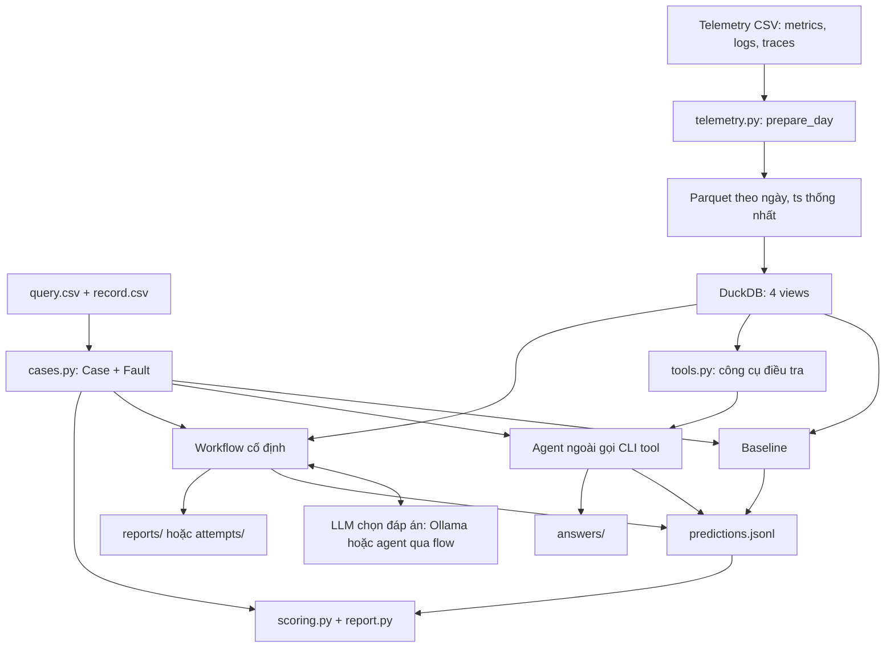

# OpenRCA agent — kiến trúc hiện tại và đánh giá

Project thử nghiệm **Root Cause Analysis (RCA) offline** trên dữ liệu Bank của
[OpenRCA](https://github.com/microsoft/OpenRCA). Đầu vào là câu hỏi về một khoảng
thời gian cùng metrics, logs và traces; đầu ra là danh sách nguyên nhân gồm
`time`, `component`, `reason`, được chấm với nhãn của bộ dữ liệu.

**Đánh giá tổng thể:** nền tảng nghiên cứu nhỏ, dễ đọc, có pipeline dữ liệu và
bộ chấm rõ ràng. Baseline, agent tự gọi công cụ và workflow cố định tạo cơ sở
để so sánh các cách suy luận. Phần điều phối LLM, kiểm tra đáp án và quản lý
thí nghiệm vẫn ở mức prototype; chưa đủ cơ sở để dùng cho vận hành production.

Tài liệu phản ánh mã nguồn ngày **04/11/2026**, sau khi dọn các nhánh thử
nghiệm (agent Ollama, Codex, TraceRCA, TORAI, multi-source BARO). Các nhánh đó
còn lưu ở branch `backup/experiments-2026-11-04`.
Tên thư mục vẫn là `human-in-the-loop-infra`, nhưng code hiện tại là package
Python `rca`, chạy qua CLI. HITL console cũ nằm ở branch `archive/hitl-infra`
(tag `hitl-infra-final`). Bản hiện tại chưa có UI, dịch vụ API, bước phê duyệt
của con người hay hành động tự sửa hạ tầng; có CLI để điều tra và ghi đáp án
thủ công.

## 1. Kiến trúc tổng quan

Ứng dụng chạy trong một tiến trình Python, xử lý tuần tự từng case. DuckDB
truy vấn Parquet tại máy. LLM nằm ngoài package: một agent (ví dụ Claude) gọi
CLI `tool` hoặc `flow`, hoặc lệnh `workflow` gọi Ollama ở bước chọn đáp án.
Không có database server hay hàng đợi trong luồng hiện tại.



Oracle, random và import đáp án OpenRCA chỉ cần cases; các baseline thống kê
mới đọc telemetry. `Case` hiện chứa cả câu hỏi lẫn ground truth, nên ranh giới
inference/evaluation dựa vào cách sử dụng code, chưa được đảm bảo bằng các
kiểu dữ liệu riêng.

| File | Trách nhiệm hiện tại |
|---|---|
| [rca/__main__.py](rca/__main__.py) | CLI, chọn case/ngày/run, điều phối và ghi kết quả. |
| [rca/cases.py](rca/cases.py) | Parse khung giờ, scoring points; ghép query với record; tạo `Case`, `Fault`. |
| [rca/bank.py](rca/bank.py) | Không gian đáp án cố định: 14 components, 8 reasons. |
| [rca/telemetry.py](rca/telemetry.py) | CSV → Parquet, chuẩn hóa timestamp, tạo DuckDB views. |
| [rca/baselines.py](rca/baselines.py) | Oracle, random, import predictions lưu sẵn của OpenRCA. |
| [rca/statistical.py](rca/statistical.py) | Xếp hạng metric bằng z-score/IQR; ánh xạ KPI sang reason. |
| [rca/baro.py](rca/baro.py) | Tích hợp `fse-baro`: BOCPD tìm điểm thay đổi, robust score xếp hạng metric. |
| [rca/exclusive_time.py](rca/exclusive_time.py) | Tool 2 của workflow: exclusive time từng component theo phút (theo CRISP), so với giờ trước. |
| [rca/microrank.py](rca/microrank.py) | MicroRank theo đúng các phương trình của bài báo (Eq. 1, 2, 4–8): PageRank cá nhân hóa trên đồ thị operation–trace, rồi Ochiai. Dùng làm baseline và trong tool `traces`. |
| [rca/tools.py](rca/tools.py) | Công cụ điều tra cho agent ngoài gọi qua CLI; ghi đáp án qua `submit`. |
| [rca/workflow.py](rca/workflow.py) | Code thu thập evidence; LLM chọn đáp án; code kiểm tra và yêu cầu sửa. |
| [rca/scoring.py](rca/scoring.py), [rca/report.py](rca/report.py) | Đọc/ghi predictions, chấm từng trường, tổng hợp theo case, độ khó và reason. |
| [tests/](tests/) | Kiểm thử parser, scorer, chuyển đổi telemetry, KPI → reason, exclusive time và MicroRank (tái tạo ví dụ số trong bài báo). |

## 2. Dữ liệu và hợp đồng giữa các lớp

### Phạm vi Bank

| Ngày telemetry, UTC+8 | Vai trò | Số câu hỏi đánh giá |
|---|---|---:|
| 2021-03-05 | Ngày bình thường để tham chiếu | 0 |
| 2021-03-09 | Đánh giá | 21 |
| 2021-03-25 | Đánh giá | 19 |

`query.csv` chứa 136 câu hỏi Bank; `baseline`, `workflow`, `score`
mặc định chọn hai ngày đánh giá trên: **40 câu hỏi, 44 lỗi**. Bốn case có hai
lỗi là `bank-104`, `bank-109`, `bank-121`, `bank-131`. Lệnh `cases` không truyền
ngày sẽ liệt kê toàn bộ câu hỏi, bao gồm ground truth.

`load_cases()` lấy trường cần chấm từ `scoring_points`, rồi tìm record khớp
trong cửa sổ thời gian; không ghép query/record theo số dòng. Case ID như
`bank-018` được tạo từ vị trí dòng trong `query.csv`, vì vậy thứ tự file này
là một phần của hợp đồng dữ liệu.

### Telemetry store

| DuckDB view | CSV nguồn trong mỗi ngày | Nội dung chính |
|---|---|---|
| `metric_app` | `metric/metric_app.csv` | KPI nghiệp vụ theo service: `sr`, `mrt`, `cnt`, `rr`, `tc`. |
| `metric_container` | `metric/metric_container.csv` | Metric theo `cmdb_id`, `kpi_name`, `value`. |
| `trace` | `trace/trace_span.csv` | Component, quan hệ parent/span, trace ID, duration. |
| `log` | `log/log_service.csv` | Component, loại log, nội dung dòng log. |

- CSV có schema và escape tường minh. Trace IDs giữ dạng chuỗi để tránh tràn
  số; `escape='"'` xử lý dấu nháy kép xuất hiện muộn trong log CSV.
- Mọi nguồn có `ts` dạng epoch giây (`DOUBLE`); cửa sổ là `start <= ts < end`.
  Câu hỏi, record và chuỗi thời gian đáp án dùng **UTC+8**.
- Đơn vị timestamp được nhận bằng độ lớn: trace ngày 05/03 và 09/03 dùng mili
  giây, ngày 25/03 dùng giây. Chuẩn hóa không khôi phục phần mili giây đã thiếu.
- Mỗi ngày/nguồn thành một Parquet nén Zstandard, sắp theo `ts`. Chuyển đổi ghi
  `.parquet.part` rồi đổi tên; file đích đã tồn tại được bỏ qua. Chưa có
  checksum/version để tự phát hiện CSV đã đổi hoặc cache cũ.
- DuckDB tạo views trên mọi ngày đã chuẩn bị. Giới hạn bộ nhớ mặc định là
  3 GB khi chuyển đổi và 2 GB khi truy vấn; không bao gồm NumPy/pandas/Ollama.

### Đáp án và artifacts

```text
data/
  Bank.zip
  openrca/Bank/{query.csv,record.csv,telemetry/<day>/...}
  parquet/Bank/<day>/{trace,log,metric_container,metric_app}.parquet
runs/<run>/
  predictions.jsonl           # Đầu vào chung của scorer
  findings.jsonl              # Top 5 findings/case của z-score hoặc IQR
  answers/<case>.json         # Đáp án từ tool submit
  reports/<case>.json         # Evidence, các lần thử và đáp án của workflow (Ollama)
  attempts/<case>.jsonl       # Các lần nộp qua flow submit và kết quả kiểm tra
```

Các file tùy theo nhánh chạy, không phải run nào cũng có đủ. `data/`, `runs/`
và `.venv/` được gitignore. Một dòng predictions có dạng:

```json
{"case_id":"bank-018","answers":[{"time":"2021-03-09 11:20:00","component":"Tomcat01","reason":"network latency"}]}
```

## 3. Ba nhánh tạo đáp án

### Baseline không dùng LLM

- **Oracle:** dùng ground truth kiểm tra bộ chấm; 100% là kiểm tra tính nhất
  quán, không phải năng lực suy luận.
- **Random:** chọn ngẫu nhiên phút, component, reason; có seed để tái lập.
- **OpenRCA agent archive:** import predictions có sẵn, không gọi agent ngoài.
- **Z-score / IQR:** so từng metric với mức tham chiếu bằng độ lệch hai phía.
  Onset là điểm đầu có score ≥ 3, hoặc điểm cực đại nếu không đạt ngưỡng.
  Regex KPI quyết định reason; chọn component khác nhau cho case nhiều lỗi.
- **BARO:** dựng bảng theo phút từ metrics, điền thiếu bằng `ffill/bfill`, dùng
  BOCPD tìm điểm thay đổi trong cửa sổ; nếu không có thì dùng đầu cửa sổ.
  Robust score ưu tiên chuỗi tăng sau điểm chia. Baseline lấy component khác
  nhau và dùng cùng thời điểm chia cho các đáp án của case.

Z-score/IQR hỗ trợ `before` (một giờ trước) hoặc `normal-day` (cùng giờ ngày
05/03, mở rộng 30 phút mỗi phía). Với `before`, chỉ khi không có findings mới
fallback sang `normal-day`. BARO không có fallback normal-day tương đương.

### Agent tự gọi công cụ (`tool`)

Một agent bên ngoài (ví dụ Claude) đọc câu hỏi bằng `tool question`, rồi tự
điều tra qua CLI. Công cụ không mang kiến thức về ý nghĩa tín hiệu; ngữ nghĩa
do agent tự suy ra.

- Công cụ thô: `overview`, `calls` (cặp gọi -> bị gọi từ trace), `series`, `logs` (grep).
- Công cụ phân phối: `baro` (mọi chuỗi metric), `exclusive` (exclusive time),
  `traces` (MicroRank, trace bất thường = chậm hơn p99 cùng loại hoặc có lời gọi thất bại).
- Vòng giả thuyết (`rca/hypotheses.py`, mặc định): agent ghi giả thuyết bằng
  `tool hypothesis <case> add|test|list` kèm điều phải thấy nếu đúng / nếu sai;
  `submit` chỉ nhận đáp án khớp một giả thuyết đã được ủng hộ và khi có ít nhất
  một giả thuyết khác đã bị bác. `tool --protocol free ...` tắt vòng này.
- Cửa sổ bình thường `normal-YYYY_MM_DD-HHMM` (cách mọi cửa sổ đề bài ít nhất
  một giờ) để khảo sát hệ thống lúc khỏe; `profiles/bank.md` là hồ sơ một agent
  Sonnet viết từ 6 cửa sổ như vậy.

`submit` kiểm tra định dạng thời gian và enum component/reason, ghi JSON và tổng
hợp lại `predictions.jsonl`. Package không chứa vòng lặp gọi LLM cho nhánh này;
luật "không đọc dữ liệu đáp án" nằm trong lời dặn cho agent.

Kết quả Sonnet (effort medium), mỗi cấu hình chạy một lần, 2026-11-06:

| Bộ ca | Vòng giả thuyết | Tự do (cùng ngân sách) | z-score |
|---|---|---|---|
| 20 ca held-out | 18/20 | chưa chạy | 6/20 |
| 30 ca held-out mới | 19/30 | 15/30 | 10/30 |

### Workflow cố định (`workflow`)

1. **Symptoms:** tổng hợp success rate và response time của nghiệp vụ.
2. **Localise:** BARO trên metrics; exclusive time từ traces (thời gian mỗi
   component tự xử lý và thời gian request đi tới nó); tìm replica giữ dưới
   50% traffic share bình thường ít nhất hai phút liên tiếp. Apache dùng
   access logs, các layer còn lại dùng traces để so sánh share.
3. **Evidence:** mỗi nguồn (BARO, exclusive time, traffic share) lần lượt góp
   một component cho tới đủ 8; mỗi candidate kèm metric score ≥ 3 theo nhóm
   CPU, memory, disk, network và các exclusive time tăng.
4. **Decide:** lệnh `workflow` gọi Ollama, trả JSON gồm component, reason,
   onset minute, giải thích và confidence (context 8.192 tokens, temperature 0).
   Hoặc một agent ngoài đóng vai LLM: `flow prompt <case>` in prompt, `flow
   submit <case> --answers '<JSON>'` kiểm tra rồi ghi đáp án.
5. **Verify/retry:** kiểm tra thời gian trong cửa sổ, bằng chứng phù hợp reason,
   onset cách bằng chứng không quá 300 giây; cho sửa tối đa hai lần.
6. **Persist:** ghi report và predictions, kể cả khi lần cuối còn lỗi kiểm tra.
   Vì vậy output chưa thể coi là đáp án đã được xác minh.

Exclusive time theo CRISP (USENIX ATC 2022): mỗi span chỉ giữ phần thời gian
không chờ span con, nên máy chỉ ngồi chờ máy khác không bị đổ lỗi. Trace Bank
gần như tuần tự và ba ngày 23–25/3 chỉ có timestamp tới giây, nên critical
path là cả trace và exclusive time = duration − tổng duration span con. Lời
gọi timeout không có span phía nhận thì không biết gọi tới đâu nên bị bỏ qua.

MicroRank được thích nghi với Bank: thiếu tên operation nên phân biệt theo
component và phía outgoing/server của span. Bài báo không ghi d, ω và số vòng
lặp; code lấy theo code của tác giả (0,85; 0,01; 25 vòng). Traces phủ IG,
Tomcat, MG và docker; apache, Mysql, Redis phải dựa vào nguồn khác.

Mức tham chiếu chưa đồng nhất: `overview`/`series`/symptoms/traffic share dùng
giờ trước nếu có `metric_app`, nếu thiếu thì dùng ngày bình thường; hai phương
pháp trace chỉ dùng giờ trước. Ranking rỗng không đồng nghĩa không có sự cố.
Eq. 1 của MicroRank cộng duration của mọi span (span cha đã bao span con), nên
trên Bank thường gần như không trace nào bị coi là bất thường.

## 4. Chấm điểm và kết quả đang có

Scorer triển khai các quy tắc được mô tả theo OpenRCA:

- Mỗi task chấm một số trường trong `time`, `component`, `reason`.
- Thời gian đúng khi lệch không quá 60 giây; component/reason khớp chính xác.
- Sai số lượng nguyên nhân thì toàn bộ trường của case nhận 0 điểm.
- Với nhiều lỗi, thử các hoán vị và chọn cách ghép nhiều trường đúng nhất.
- Điểm case = số trường đúng / số trường được chấm; `solved` khi điểm bằng 1.
  `strict` là tỷ lệ case solved; `partial` là trung bình điểm các case,
  không phải tỷ lệ gộp mọi trường. Task 1–3/easy, 4–6/middle, 7/hard.
- Case thiếu prediction vẫn nằm trong mẫu số và được chấm 0.

Snapshot tính ngày 30/10/2026 từ predictions đã lưu; thư mục `runs/` đã được
xóa ngày 04/11/2026, các baseline chạy lại được bằng lệnh ở mục 6. Các run
không có manifest gắn với revision/prompt/model digest, nên bảng không chứng
minh code hiện tại sẽ tái tạo y hệt.

| Run đủ 40 case | Giải đúng | Partial |
|---|---:|---:|
| `oracle` | 40/40 | 100,0% |
| `agent-tools` | 30/40 | 82,3% |
| `zscore-before` | 13/40 | 37,7% |
| `iqr-before` | 10/40 | 33,8% |
| `baro` | 7/40 | 25,0% |
| `openrca-agent` | 4/40 | 14,6% |
| `random` (file đã lưu) | 4/40 | 17,7% |
| `iqr-normal-day` | 3/40 | 13,8% |
| `zscore-normal-day` | 2/40 | 13,1% |

`agent-tools` là đáp án của agent Claude gọi CLI `tool` (bốn subagent, mỗi
case một lần); các công cụ và lời dặn được viết sau khi đã xem một số case
dev, nên con số này lạc quan. Oracle cũng không phải đối thủ RCA thực tế.

Mốc may rủi qua seed 0–1999: random trung bình giải đúng 1,9/40, partial 11,1%;
11,65% lần thử đạt ít nhất 4/40. Chênh lệch vài case cần được diễn giải cùng
coverage, loại task và cách chọn tập đánh giá.

Qua bước kiểm tra bằng chứng không đảm bảo đáp án đúng: kiểm tra chỉ xét
bằng chứng có khớp loại lỗi và thời điểm hay không. Repo hiện không kèm
scorer/archive chính thức để kiểm chứng lại tuyên bố tương đương bộ chấm
OpenRCA trên toàn bộ 136 câu hỏi.

## 5. Đánh giá kiến trúc

### Điểm mạnh

- **Nền dữ liệu phù hợp nghiên cứu offline:** schema rõ, xử lý UTC+8, đơn vị
  timestamp và ID dạng text; Parquet + DuckDB giảm nhu cầu hạ tầng riêng.
- **Có thước đo chung:** mọi nhánh xuất cùng `Answer`/JSONL và dùng cùng scorer.
  Oracle/random giúp phát hiện lỗi chấm và diễn giải kết quả của run nhỏ.
- **Dễ lần theo quyết định:** thuật toán ở các module riêng; workflow lưu
  evidence/từng lần thử, agent lưu tool calls để điều tra sai sót.
- **Hai cách dùng LLM có mục đích rõ:** agent khám phá linh hoạt; workflow
  chủ động chuẩn bị dữ liệu, giảm yêu cầu model phải chọn tool tốt.
- **Kết hợp nhiều nguồn tín hiệu:** metrics, traces và traffic share bổ sung
  cho nhau ở các component có độ phủ telemetry khác nhau.

### Hạn chế cần xử lý

| Vấn đề thấy trong code | Ảnh hưởng |
|---|---|
| Dependencies chính chỉ khai báo DuckDB, nhưng CLI import `tools → microrank → numpy` ngay khi khởi động. | Cài mặc định sạch thiếu NumPy có thể lỗi cả `--help`. Group `baro` đang cung cấp NumPy gián tiếp. |
| `Case` truyền vào phần suy luận chứa `faults`; số đáp án lấy từ `len(case.faults)`. | Prompt không nhận các giá trị ground truth, nhưng inference vẫn phụ thuộc nhãn và chưa có ranh giới chống dùng nhãn nhầm. |
| Workflow hết retry vẫn ghi đáp án; tolerance onset bằng chứng là 300 giây; kiểm tra cấm hai lỗi trùng component trong khi `bank-028`, `bank-029` có hai lỗi cùng component. | Đáp án có thể thiếu bằng chứng, trong khi scorer chỉ cho lệch 60 giây so với nhãn; hai case trên không thể đúng hết. |
| Schema giờ cho phép `24:00`–`29:59`; chưa kiểm tra response đầy đủ; CLI agent/workflow chỉ bắt `OSError`. | JSON lỗi, trường thiếu hoặc giờ không hợp lệ có thể làm dừng cả lệnh, thay vì ghi lỗi riêng cho case. |
| Evidence chủ yếu dựa vào metric và exclusive time tăng. | Tín hiệu giảm, missing data, phân biệt latency/packet loss còn dựa nhiều vào heuristic. |
| BARO fallback về đầu cửa sổ nhưng phần mô tả vẫn gọi đó là BOCPD change point. | Report chưa phân biệt điểm thay đổi phát hiện được với mốc mặc định. |
| Topology, KPI regex, component/reason và ngày bình thường gắn cứng với Bank. | `--system` đổi đường dẫn, chưa biến hệ thống thành RCA đa dataset. |
| Thiếu manifest run; ghi predictions chưa atomic; chạy lại cùng tên tái sử dụng kết quả cũ. | Khó tái lập/so sánh sạch; lỗi khi chạy lại có thể để lại đáp án cũ. Chưa phù hợp nhiều worker ghi cùng run. |
| Tests tập trung ở parser, scorer, telemetry, KPI mapping và MicroRank. | Chưa có test riêng cho workflow verify/retry, BARO và quản lý artifacts. |

BARO dùng pandas và điền dữ liệu nhìn cả cửa sổ; MicroRank dùng ma trận NumPy
dense theo operations/traces. Đây là thiết kế offline, chưa có benchmark tài
nguyên để khẳng định khả năng xử lý stream hay tải production. Các ngưỡng và
`confidence` của LLM cũng chưa được hiệu chỉnh bằng đánh giá độc lập.

### Thứ tự cải thiện đề xuất

1. **Làm kết quả đáng tin hơn:** khai báo dependency trực tiếp; kiểm tra response
   và thời gian ở runtime; lưu `accepted/rejected/error` sau verify; giữ dự đoán
   thô để vẫn chấm được kết quả thất bại.
2. **Tách inference/evaluation:** input chỉ có câu hỏi, cửa sổ và số lỗi lấy từ
   yêu cầu; giữ `Fault` ở lớp chấm. Gom cấu hình Bank vào adapter.
3. **Làm thí nghiệm tái lập được:** lưu code revision, cấu hình/prompt, model
   digest, seed và tập case; ghi atomic; quy định resume/overwrite; so sánh
   trên cùng tập case, báo riêng case lỗi/thiếu.
4. **Cải thiện evidence rồi đánh giá lại:** hợp nhất candidates với ưu tiên rõ
   giữa các nguồn; thống nhất reference/missing data; thêm test multi-fault,
   duplicate, timeout và JSON lỗi. Sau đó mở rộng bước review của người dùng
   nếu mục tiêu là hỗ trợ vận hành HITL.

## 6. Cách chạy với code hiện tại

Cần Python ≥ 3.13, `uv`, dữ liệu `Bank.zip`. Lệnh `workflow` cần Ollama đang
chạy và có sẵn model tương ứng; URL mặc định `http://localhost:11434`, đổi
qua `--url`. Các ví dụ dùng group `baro` để có đủ dependency cho toàn bộ CLI hiện
tại, bao gồm NumPy đang được import gián tiếp.

```bash
# Đặt Bank.zip vào data/, giải nén có chọn lọc.
unzip -q data/Bank.zip 'Bank/query.csv' 'Bank/record.csv' \
  'Bank/telemetry/2021_03_05/*' 'Bank/telemetry/2021_03_09/*' \
  'Bank/telemetry/2021_03_25/*' -d data/openrca

uv sync --group baro
uv run --group baro python -m rca prepare
uv run --group baro python -m rca cases 2021_03_09 2021_03_25 --counts
uv run --group baro pytest
```

Tạo baseline và chấm kết quả:

```bash
uv run --group baro python -m rca baseline oracle
uv run --group baro python -m rca baseline random --seed 0
uv run --group baro python -m rca baseline zscore --reference before
uv run --group baro python -m rca baseline iqr --reference normal-day
uv run --group baro python -m rca baseline baro
uv run --group baro python -m rca baseline openrca-agent \
  --archive path/to/OpenRCA/rca/archive/agent-Bank.csv
uv run --group baro python -m rca score runs/*/predictions.jsonl
```

Điều tra một case, chạy workflow, hoặc để một agent ngoài làm bước chọn:

```bash
uv run --group baro python -m rca tool question bank-018
uv run --group baro python -m rca tool overview bank-018
uv run --group baro python -m rca tool baro bank-018 --top 10
uv run --group baro python -m rca tool exclusive bank-018
uv run --group baro python -m rca tool calls bank-018
uv run --group baro python -m rca tool series bank-018 Tomcat01 CPU
uv run --group baro python -m rca tool traces bank-018
uv run --group baro python -m rca tool hypothesis bank-018 --run demo add --component Tomcat01 \
  --reason "network latency" --if-true "..." --if-false "..."
uv run --group baro python -m rca tool question normal-2021_03_06-0930

uv run --group baro python -m rca workflow \
  --model qwen3:4b-instruct-2507-q4_K_M --cases bank-018 --run demo-workflow
uv run --group baro python -m rca flow prompt bank-018
uv run --group baro python -m rca flow submit bank-018 --run demo-flow \
  --answers '{"answers": [{"component": "Tomcat01", "reason": "network latency", "onset_minute": "11:20", "why": "..."}], "confidence": "medium"}'
uv run --group baro python -m rca score \
  runs/demo-workflow/predictions.jsonl runs/demo-flow/predictions.jsonl \
  --cases bank-018 --detail
```

Dùng tên `--run` mới cho mỗi thí nghiệm cần tách biệt. Tùy chọn chung `--data`,
`--system`, `--runs` đứng **trước** subcommand, ví dụ
`python -m rca --data /path/to/data cases 2021_03_09`.

Sau lần dọn ngày 04/11/2026 và khi thêm tool 2, **38 tests đều pass** bằng
`uv run --group baro pytest -q`.
# rca-agent
