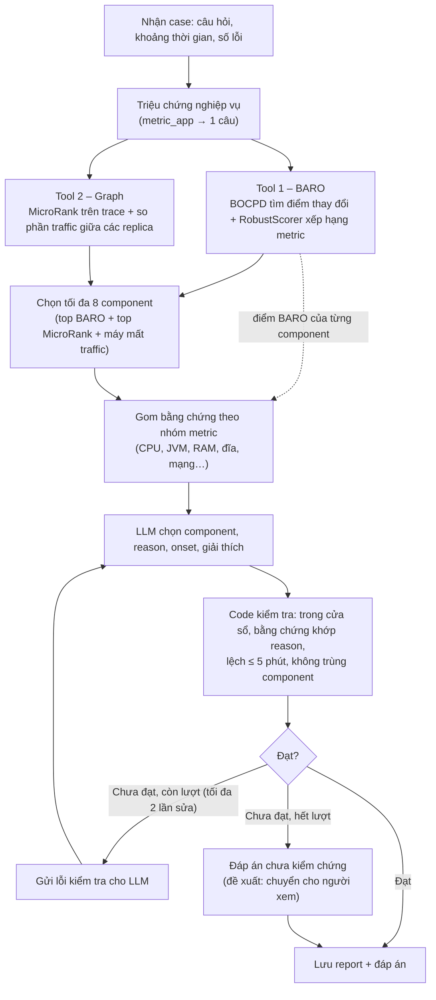

# Phần 1. Hệ thống hoạt động như thế nào

Tìm nguyên nhân gốc (RCA) trong hệ thống nhiều service
từ **metric, trace, log**: BARO + MicroRank + LLM

Dữ liệu minh họa: OpenRCA – hệ thống ngân hàng (Bank)

---

## Bài toán

- Mỗi câu hỏi cho một **cửa sổ 30 phút**; trong đó có **1 lỗi** (87% câu) hoặc **2 lỗi** (13% câu)
- Cửa sổ là phạm vi tìm kiếm. **Bản thân sự cố ngắn hơn nhiều** (thường vài phút) và có thể bắt đầu ở bất kỳ phút nào trong cửa sổ
- Cần trả lời: **thời điểm** (sai số ≤ 60 giây), **máy** (1 trong 14), **lý do** (1 trong 8)

| 14 máy | 8 lý do |
|---|---|
| apache01/02, IG01/02, Tomcat01–04, MG01/02, Mysql01/02, Redis01/02 | high CPU, high memory, network latency, network packet loss, disk I/O read, disk space, JVM CPU load, JVM OOM |

---

## Hệ thống Bank

apache → IG (gateway) → Tomcat (app, JVM) → MG (middleware) → docker services
Mysql, Redis là kho dữ liệu

- Mỗi tầng có 2–4 bản sao: một bản lỗi thì tầng trên chuyển sang bản còn lại
- Vì vậy lỗi hay bị che, **người dùng thường không thấy gì**
- apache, Mysql, Redis **không có trong trace**

---

## Dữ liệu đầu vào (1/2): metric

| File | Cột | Ý nghĩa |
|---|---|---|
| `metric_container` | timestamp, cmdb_id, kpi_name, value | Số đo của **từng máy**: CPU, đĩa, mạng, RAM, JVM... |
| `metric_app` | timestamp, rr, sr, cnt, mrt, tc | Chỉ số nghiệp vụ **theo service**: tỉ lệ thành công, số request, thời gian phản hồi |

- Khoảng 1,2 triệu dòng mỗi ngày; mỗi máy 60–100 loại metric (**~800 chuỗi** mỗi cửa sổ)
- Lấy mẫu 60–120 giây, gom lại theo phút

---

## Dữ liệu đầu vào (2/2): trace và log

**Trace** `trace_span`: timestamp, cmdb_id, parent_id, span_id, trace_id, duration (ms)
- 12–25 triệu span mỗi ngày
- span_id bắt đầu bằng `369-` là **cuộc gọi đi** (client), còn lại là phía nhận (server)
- Chỉ có IG, Tomcat, MG, docker

**Log** `log_service`: timestamp, cmdb_id, log_name, value
- 8 máy có log; **99% là access log** (mỗi request một dòng, hầu hết mã 200)
- Log GC, slow query, catalina rất ít
- IG, MG, Redis không có log

---

## Pipeline



> Code làm các bước cố định; LLM chỉ **đọc bằng chứng đã được tóm tắt** rồi chọn

---

## Vai trò từng thành phần

| Thành phần | Làm gì | Mạnh với |
|---|---|---|
| Triệu chứng | So tỉ lệ thành công, thời gian phản hồi với giờ trước | Biết **người dùng có bị ảnh hưởng không** |
| BARO | Tìm thời điểm đổi + xếp hạng metric bất thường | Lỗi **tài nguyên** (CPU, đĩa, RAM) |
| MicroRank | Xếp hạng máy qua các trace chậm | Lỗi **mạng** trên máy có trace |
| So traffic replica | Máy nào mất phần traffic so với máy anh em | Máy **không có trace** (apache) |
| LLM | Đọc bằng chứng, lọc nhiễu, chọn đáp án | Suy luận, phân loại lý do |
| Code kiểm chứng | Đáp án có bằng chứng khớp không | Chặn đáp án thiếu căn cứ |

---

## BARO (1/2): ý tưởng

1. **BOCPD** (phát hiện điểm thay đổi kiểu Bayes, đa biến) chạy trên bảng *phút × chuỗi*, tìm phút $\hat t_A$ mà hệ thống bắt đầu đổi
2. **RobustScorer** chấm từng chuỗi metric: giai đoạn sau $\hat t_A$ lệch bao nhiêu so với giai đoạn trước

$$a_t = \frac{|x_t - \text{median}|}{\text{IQR}} \qquad \rho = \max_{t \ge \hat t_A} a_t$$

- median và IQR (khoảng giữa phân vị 25% và 75%) lấy từ **giai đoạn trước** $\hat t_A$
- Dùng median/IQR thay mean/std vì **ít bị điểm lạ kéo lệch**, chịu được việc chọn $\hat t_A$ chưa chính xác
- Xếp các chuỗi theo $\rho$ giảm dần: đầu bảng là nghi phạm
- Package của tác giả (pipeline đang dùng) bỏ dấu trị tuyệt đối, chỉ tính chiều **tăng**: $a_t = (x_t - \text{median}) / \text{IQR}$

---

## BARO (2/2): dữ liệu vào và đầu ra

**Vào:** bảng 90 phút × ~1.670 cột, mỗi cột `<máy>|<kpi>` (+ `<service>_latency`, `<service>_error`)
- Bỏ cột hằng số, điền ô trống bằng giá trị phút trước
- BOCPD chạy trên latency và tỉ lệ lỗi

**Ra (đưa cho LLM):** mỗi máy giữ 1 metric mạnh nhất

```
Mysql02: LOCALDISK-sda_DSKRead 0.40 -> 2308.00 (robust score 824, from 13:22)
MG02:    TCP FIN-WAIT           0.00 -> 6.00    (robust score 6,   from 13:11)
```

---

## MicroRank (1/4): ý tưởng và trace bất thường

Ý tưởng (phân tích phổ): thao tác nằm trên **nhiều trace bất thường** và **ít trace bình thường** là nghi phạm. PageRank cân trọng số cho từng trace trước khi đếm.

**Thao tác** $o$ = máy + phía (`Tomcat04:call` hoặc `Tomcat04:serve`), vì trace Bank không có tên API

**Trace bất thường** (Eq. 1):

$$L_{expected} = \sum_{o} count_o \cdot \big(\mu_o + n\,\sigma_o\big), \qquad n = 1.5$$

- $count_o$: số span của thao tác $o$ trong trace · $\mu_o, \sigma_o$: trung bình, độ lệch chuẩn của $o$ ở giờ trước
- Trace bất thường nếu độ trễ thực > $L_{expected}$

**Loại trace (kind):** các trace có cùng **cây phủ** (thao tác + quan hệ cha–con) là cùng loại

---

## MicroRank (2/4): đồ thị và ma trận chuyển

Đồ thị có 2 loại nút: **thao tác** và **trace**. Cạnh: thao tác → thao tác (lời gọi), trace ↔ thao tác (trace phủ thao tác)

$$A = \begin{bmatrix} \omega A_{oo} & A_{ot} \\ A_{to} & 0 \end{bmatrix} \quad \text{(Eq. 5–6)}, \qquad \omega = 0.01$$

Mỗi bước đi chia đều cho các nút kề (Eq. 2):

- $A_{oo}[j, i] = 1 / |\text{callee}(i)|$ nếu thao tác $i$ gọi $j$
- $A_{ot}[o, t] = 1 / |O(t)|$ nếu trace $t$ phủ thao tác $o$
- $A_{to}[t, o] = 1 / |T(o)|$ nếu thao tác $o$ nằm trong trace $t$

$O(t)$: các thao tác trace $t$ phủ · $T(o)$: các trace phủ thao tác $o$ · $\omega$ nhỏ: lời gọi chỉ dùng để phân biệt các thao tác cùng nằm trên một nhóm trace

---

## MicroRank (3/4): PageRank cá nhân hóa

Vector ưu tiên chỉ đặt trên trace, $u = [\,\mathbf{0};\ \theta\,]$ (Eq. 7):

$$\theta_i = \varphi \cdot \frac{n_i^{-1}}{\sum_j n_j^{-1}} + (1-\varphi) \cdot \frac{k_i^{-1}}{\sum_j k_j^{-1}}, \qquad \varphi = 0.5$$

- $n_i$: số thao tác trace $i$ phủ · $k_i$: số trace cùng loại với $i$ · nhóm bình thường chỉ dùng phần $k$
- Ý nghĩa: trace **phủ ít thao tác** khoanh vùng hẹp hơn, nên quan trọng hơn; **loại trace hiếm** không bị loại phổ biến lấn át

Lặp (Eq. 4), chạy riêng cho nhóm bất thường và nhóm bình thường:

$$v^{(q)} = d \cdot A\, v^{(q-1)} + (1-d) \cdot u, \qquad d = 0.85$$

Kết quả: điểm $F(o)$ (bất thường) và $P(o)$ (bình thường), chuẩn hóa để lớn nhất bằng 1

<small>Bài báo không ghi $d$, $\omega$ và số vòng lặp; lấy theo code tác giả: 25 vòng, mỗi vòng chuẩn hóa $v$ về lớn nhất bằng 1. Cài đặt tái tạo đúng ví dụ số trong bài: $u = [8/21,\ 13/42,\ 13/42]$, $F = [0.990,\ 0.328,\ 0.328,\ 1]$.</small>

---

## MicroRank (4/4): phổ có trọng số, vào và ra

Phổ có trọng số (Eq. 8):

$$O_{ef} = F \cdot N_{ef}, \qquad O_{nf} = F \cdot (N_f - N_{ef}), \qquad O_{ep} = P \cdot N_{ep}$$

$N_{ef}, N_{ep}$: số trace bất thường / bình thường phủ thao tác · $N_f$: tổng số trace bất thường · thao tác không có điểm thì $F$ hoặc $P = 0.0001$

Điểm **Ochiai** (công thức mặc định của bài báo):

$$\text{score}(o) = \frac{O_{ef}}{\sqrt{(O_{ef} + O_{ep})(O_{ef} + O_{nf})}}$$

Điểm của máy = điểm cao nhất trong các thao tác của nó

**Vào** (ví dụ một cửa sổ): 802.228 span → **40.827 trace**, ví dụ `gw01...1645 | 2777 ms | [dockerA1:serve, MG02:call, MG02:serve, Tomcat04:serve, IG01:call, ...]`

**Ra:** `IG01: 1.00, IG02: 0.86, Tomcat01: 0.84, Tomcat03: 0.72, Tomcat04: 0.60`

---

## Tool Graph: so traffic giữa các replica (bổ sung của nhóm)

MicroRank không thấy máy không có trace (apache, Mysql, Redis). Nhóm thêm phép so **phần traffic** của mỗi máy trong tầng của nó:

$$share_i(t) = \frac{n_i(t)}{\sum_j n_j(t)}$$

- $n_i(t)$: số span của máy $i$ trong phút $t$; với apache là số dòng access log
- Cảnh báo nếu $share_i(t) < 0.5 \cdot share_i^{\text{bình thường}}$ trong ≥ 2 phút liên tiếp
- Ra: *"MG02 chỉ còn 0% phần traffic của MG01/MG02 từ 13:10 đến 13:15; MG01 nhận thay"*

---

## LLM dùng kết quả của tool để suy luận

**Đầu vào (~60 dòng, do code dựng sẵn):** danh sách máy và lý do hợp lệ · triệu chứng · kết quả BARO · kết quả Graph · bằng chứng từng ứng viên · **các quy tắc backend**

Ví dụ quy tắc:
- CPU của OS tăng mà JVM CPU không đổi → `high CPU usage`
- Máy mất traffic, máy anh em nhận thêm, CPU/RAM/đĩa không đổi → **lỗi mạng ở máy mất**
- Đột biến 1 điểm, hoặc đã bất thường từ trước → không phải nguyên nhân

**Đầu ra:** JSON ép theo schema `{component, reason, onset_minute, why}`

**Kiểm chứng (code):** phút nằm trong cửa sổ · bằng chứng khớp loại lỗi · bằng chứng bắt đầu cách phút chọn ≤ 5 phút · không trùng máy
→ sai thì gửi lỗi cho LLM, **tối đa 2 lần sửa**

---

## Ca LLM xử lý tốt 1: MG02 mất gói (13:10)

**Đề:** hỏi máy và lý do · **không có ảnh hưởng nghiệp vụ** (failover che lỗi)

| Tool | Thấy gì |
|---|---|
| BARO | Đứng đầu là **nhiễu**: đĩa Mysql02 (824 điểm), một core của apache01 (412 điểm). MG02 chỉ có FIN-WAIT 0→6 |
| Graph | MicroRank xếp IG01 đầu, MG02 không vào top 5. **Nhưng:** *MG02 chỉ còn 0% phần traffic từ 13:10, MG01 nhận thay* |

**LLM:** bỏ qua hạng đầu của BARO và MicroRank, theo câu tóm tắt của tool graph cùng quy tắc → **MG02, network packet loss, 13:10** ✔

**Ưu:** câu tóm tắt rõ + quy tắc → LLM lọc được nhiễu và không nhầm máy khỏe (MG01) là nguyên nhân
**Nhược:** phụ thuộc vào một tín hiệu duy nhất (mất traffic)

---

## Ca LLM xử lý tốt 2: Tomcat02 OOM (16:23)

**Đề:** chỉ hỏi **thời điểm** · phản hồi lên tới 9 giây

| Tool | Thấy gì |
|---|---|
| BARO | Tomcat02: RAM (không tính cache) 42.8 → 51.3 %, CPU 27.7 → 79.9 %, cùng từ 16:24 |
| Graph | MicroRank xếp **dockerA1, dockerA2, MG02** đầu: 277 trace bị coi là bất thường lệch về các trace có gọi docker, không tập trung vào Tomcat02. Tomcat03 mất phần traffic từ 16:27 |

**LLM:** chọn thay đổi sớm và mạnh nhất trong bằng chứng BARO, không theo hạng đầu MicroRank và không theo Tomcat03 → **Tomcat02, 16:24** ✔ (đáp án 16:23, trong ±60 giây)

**Ưu:** LLM gạt được hai tín hiệu sai của tool graph
**Nhược:** lý do chọn là *high memory usage*, còn nguyên nhân thật là **OOM**, vì pipeline chưa thấy log GC (1 → 56 dòng/phút). Ca này đúng vì đề chỉ hỏi thời điểm.

---

## Ca LLM chưa xử lý tốt 1: apache01 mất gói (20:25)

**Đề:** hỏi cả 3 trường · apache **không có trace**

| Tool | Thấy gì |
|---|---|
| BARO | **FIN-WAIT 0→59 bị loại** (cột hằng số trước đó). Đầu bảng là nhiễu: Mysql02, core nhảy, **đĩa MG02 0→152 chỉ 1 phút** |
| Graph | MicroRank không có kết quả. ✔ *apache01 chỉ còn 5% phần traffic từ 20:25; apache02 nhận thay* |

**LLM:** chọn **MG02, disk I/O, 20:13** ✘, bị con số 152 của nhiễu thu hút. Bước kiểm chứng vẫn cho qua vì chưa kiểm tra độ dài của bằng chứng.

**Nhược:** tool graph **đã tìm đúng**, nhưng bằng chứng nhiễu lấn át · BARO làm mất tín hiệu quan trọng nhất · kiểm chứng còn lỏng

---

## Ca LLM chưa xử lý tốt 2: Tomcat01 network latency (11:20)

**Đề:** hỏi máy và lý do · tỉ lệ thành công còn ~72% từ 11:20 đến 11:24 (1 trong 4 Tomcat không phản hồi)

| Tool | Thấy gì |
|---|---|
| BARO | Đầu bảng toàn nhiễu đĩa và core (IG01, apache01, Mysql01...). 8 chỗ ứng viên bị chiếm hết, **Tomcat01 không có bằng chứng metric** |
| Graph | MicroRank **không có kết quả**: Eq. 1 không đánh dấu trace nào bất thường (giờ trước chậm hơn cả cửa sổ). ✔ *Tomcat01 chỉ còn 0% phần traffic 11:20–11:24* |

**LLM:** theo câu của tool graph → **Tomcat01** ✔, nhưng chọn *network packet loss* trong khi đáp án là **latency** ✘

**Nhược:**
- Khi độ trễ rất lớn, latency và loss cho **cùng một biểu hiện** (traffic sập, FIN-WAIT); cần thời gian từng cạnh gọi (timeout 15,4 giây từ IG tới Tomcat01) nhưng pipeline chưa dùng
- MicroRank phụ thuộc giờ trước có bình thường không; ứng viên ưu tiên BARO nên máy lỗi bị đẩy khỏi phần bằng chứng

---

## Ưu và nhược

| Ưu | Nhược |
|---|---|
| Code cố định → **tái lập, kiểm chứng được**, nhanh | Bằng chứng gom sẵn, **không đi lấy thêm** theo giả thuyết; 8 chỗ ứng viên ưu tiên BARO |
| LLM chỉ đọc bản tóm tắt, có quy tắc backend → **lọc nhiễu, giải thích được** | BARO: metric hệ điều hành rất nhiễu, mất cột "phẳng rồi bật lên" |
| Hai tool bù nhau (tài nguyên và mạng) | MicroRank: mù với apache/Mysql/Redis, nghiêng về máy nằm trên nhiều đường đi; Eq. 1 có lúc không bắt được trace nào |
| Tool so traffic xử lý được máy không có trace | Chưa phân biệt latency và loss; chưa dùng log GC |
| Vòng kiểm chứng bắt đáp án thiếu căn cứ | Kiểm chứng còn lỏng; hết lượt vẫn nộp đáp án chưa kiểm chứng |

**Hướng phát triển:** truy xuất bằng chứng theo giả thuyết · so với cùng giờ ngày khác · phân tích từng cạnh gọi · chuyển cho người xem khi không chắc
